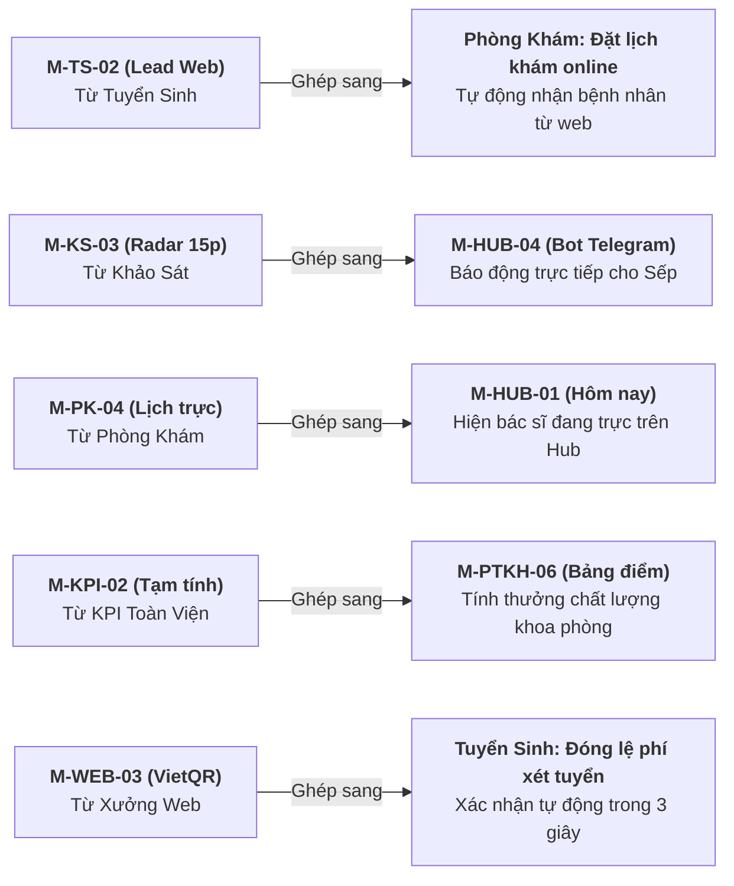

# KIẾN TRÚC FRACTAL MODULE & DANH MỤC TÍNH NĂNG TOÀN HỆ SHIN

> [!IMPORTANT]
> **TRIẾT LÝ THIẾT KẾ FRACTAL MODULE (SẾP HUỲNH TRƯỜNG THANH TÂM):**  
> *"Mỗi App là 1 Module lớn (Macro-Module), và mỗi Tính năng trong App là 1 Module nhỏ (Micro-Module). Toàn bộ hệ thống là các khối Lego độc lập: chỉ cần khớp chuẩn hợp đồng Đầu vào (Input) và Đầu ra (Output) thì bất kỳ Module nhỏ nào cũng có thể tách rời, hoán đổi hoặc ghép nối trực tiếp sang một App khác hay bất kỳ vị trí nào trong hệ sinh thái."*

---

## 1. SƠ ĐỒ MINDMAP FRACTAL MODULE TOÀN HỆ SINH THÁI

```mermaid
flowchart TD
    SHIN["<b>HỆ SINH THÁI SHIN AIOS</b><br><i>Hạ tầng Liên thông Hợp đồng I/O</i>"]

    %% 8 Macro-Apps
    SHIN --> APP_HUB["🏢 1. MACRO: EXECUTIVE HUB (10_Hub)"]
    SHIN --> APP_KPI["📊 2. MACRO: KPI TOÀN VIỆN (30_KPI)"]
    SHIN --> APP_TS["🎓 3. MACRO: TUYỂN SINH (60_TS)"]
    SHIN --> APP_KS["🩺 4. MACRO: KHẢO SÁT HÀI LÒNG (70_KS)"]
    SHIN --> APP_PK["🏥 5. MACRO: PHÒNG KHÁM MỚI (21_PK)"]
    SHIN --> APP_PTKH["📁 6. MACRO: PTKH DI SẢN (20_PTKH)"]
    SHIN --> APP_WEB["🌐 7. MACRO: XƯỞNG WEB (03_XuongWeb)"]
    SHIN --> APP_TACVU["⚙️ 8. MACRO: TỰ ĐỘNG HÓA (_TacVu & AI)"]

    %% Micro-modules HUB
    APP_HUB --> M_HUB_1["M-HUB-01: Gom việc hôm nay (tomTat/viec)"]
    APP_HUB --> M_HUB_2["M-HUB-02: Bàn điều hành 2 chiều 🧭"]
    APP_HUB --> M_HUB_3["M-HUB-03: Sổ việc riêng (Personal To-do)"]
    APP_HUB --> M_HUB_4["M-HUB-04: Điều phối Telegram Bot tập trung"]
    APP_HUB --> M_HUB_5["M-HUB-05: Danh bạ SSO & Cấp Token HMAC"]

    %% Micro-modules KPI
    APP_KPI --> M_KPI_1["M-KPI-01: Bộ đệm đọc TV3 Read-Only"]
    APP_KPI --> M_KPI_2["M-KPI-02: Bản tin tạm tính tháng tự động"]
    APP_KPI --> M_KPI_3["M-KPI-03: Soát lỗi chốt quý đa chiều"]
    APP_KPI --> M_KPI_4["M-KPI-04: Thẩm định & Giám sát AOP"]
    APP_KPI --> M_KPI_5["M-KPI-05: Nháp báo cáo quý sang Docs"]

    %% Micro-modules TS
    APP_TS --> M_TS_1["M-TS-01: Quản trị chiến dịch tuyển sinh"]
    APP_TS --> M_TS_2["M-TS-02: Cổng tiếp nhận Lead Web (anti-spam)"]
    APP_TS --> M_TS_3["M-TS-03: Bảng tính hoa hồng bậc thang lũy tiến"]
    APP_TS --> M_TS_4["M-TS-04: Quản lý vòng đời ứng viên (Pipeline)"]

    %% Micro-modules KS
    APP_KS --> M_KS_1["M-KS-01: Bộ tạo & Quản lý mẫu khảo sát"]
    APP_KS --> M_KS_2["M-KS-02: Chấm điểm 5 trụ cột ACHSI"]
    APP_KS --> M_KS_3["M-KS-03: Radar cảnh báo khẩn cấp 15 phút"]
    APP_KS --> M_KS_4["M-KS-04: Biểu đồ xu hướng hài lòng bác sĩ/khoa"]

    %% Micro-modules PK
    APP_PK --> M_PK_1["M-PK-01: Báo cáo ngày ca trực"]
    APP_PK --> M_PK_2["M-PK-02: Upload & Lưu trữ minh chứng ảnh Drive"]
    APP_PK --> M_PK_3["M-PK-03: Phân công & Theo dõi việc theo ca"]
    APP_PK --> M_PK_4["M-PK-04: Ma trận xếp lịch tuần & Đổi ca trực"]
    APP_PK --> M_PK_5["M-PK-05: Hòm thư góp ý nội bộ bảo mật"]

    %% Micro-modules PTKH (Legacy Assets)
    APP_PTKH --> M_PTKH_1["M-PTKH-01: Khung Cảm nhận ngày làm việc"]
    APP_PTKH --> M_PTKH_2["M-PTKH-02: Quy trình duyệt báo cáo 2 cấp"]
    APP_PTKH --> M_PTKH_3["M-PTKH-03: Bóc tách tăng ca & Bù giờ (TC-NS)"]
    APP_PTKH --> M_PTKH_4["M-PTKH-04: Đếm vi phạm NTC tuần & Trừ công"]
    APP_PTKH --> M_PTKH_5["M-PTKH-05: Khảo sát nội trú F.KS 34.000 dòng"]
    APP_PTKH --> M_PTKH_6["M-PTKH-06: Bảng tổng quan hiệu suất nhân viên"]

    %% Micro-modules Xưởng Web
    APP_WEB --> M_WEB_1["M-WEB-01: Kiến trúc phễu lặn biển (0m đến -105m)"]
    APP_WEB --> M_WEB_2["M-WEB-02: Máy sinh mã tĩnh Tailwind + 8 Palettes"]
    APP_WEB --> M_WEB_3["M-WEB-03: Tích hợp VietQR SePay tự động"]

    %% Micro-modules Tác Vụ
    APP_TACVU --> M_TACVU_1["M-TACVU-01: Lập phiếu kế hoạch (10h57/22h57)"]
    APP_TACVU --> M_TACVU_2["M-TACVU-02: Viết mã tự động mỗi giờ :27"]
    APP_TACVU --> M_TACVU_3["M-TACVU-03: Rà soát UX & Kiểm thử (21h22/08h22)"]
    APP_TACVU --> M_TACVU_4["M-TACVU-04: Cắt bản đạt đưa app (09h52/16h52)"]
    APP_TACVU --> M_TACVU_5["M-TACVU-05: Cầu nối AI Claude ↔ Antigravity AGY"]
    APP_TACVU --> M_TACVU_6["M-TACVU-06: Đồ thị tri thức Obsidian Second Brain"]
```

---

## 2. TỪ ĐIỂN BÁCH KHOA MICRO-MODULES (HỢP ĐỒNG INPUT - XỬ LÝ - OUTPUT)

### 🏢 NHÓM 1: EXECUTIVE HUB (`10_Hub`)
| Mã Module | Tên Module | Input (Đầu vào) | Logic Xử lý Cốt lõi | Output (Đầu ra) | Khả năng Ghép nối Chéo |
|---|---|---|---|---|---|
| **M-HUB-01** | **Gom Việc & Thẻ Số Hôm Nay** | Mã nhân sự (`maNguoi`), Cổng `tomTat` & `viec` của các app con | Kéo định kỳ 90p hoặc bấm nút Làm mới; sắp xếp thứ tự: Khẩn cấp → Quan trọng → Hạn gần | Mảng thẻ số `{nhan, giaTri, den}` + Danh sách việc `{id, app, tieuDe, han, link}` | Ghép vào trang chủ của bất kỳ app vệ tinh nào để nhân viên không cần mở nhiều app. |
| **M-HUB-02** | **Bàn Điều Hành 2 Chiều 🧭** | Quyết định duyệt của Sếp (`Dxx`, `Qxx`), Lệnh giao việc cho Shin AI | Quét tệp kế hoạch, ghi quyết định vào `QUYET_DINH.md`; đẩy việc giao vào cuối hàng đợi Lxx của app đích | Phản hồi 3 bước: *Đã gửi → Máy đã nhận → Đã làm*; cập nhật tiến độ % toàn hệ | Có thể nhúng thành một tab "Điều phối" trong app KPI của Ban Kiểm Soát. |
| **M-HUB-03** | **Sổ Việc Riêng (To-do)** | Tiêu đề việc, hạn hoàn thành, mức độ ưu tiên | Lưu trực tiếp vào Sheet dữ liệu cá nhân của người dùng, phân loại đã xong / chưa xong | Danh sách checklist cá nhân, tự động ẩn việc đã xong sau 24h | Ghép vào tab `👤 Tôi` của mọi app trong hệ. |
| **M-HUB-04** | **Điều Phối Bot Telegram** | Sự kiện khẩn cấp từ app con (`suKien` với `muc: 'gap'`) | Kiểm tra giới hạn tần suất (rate-limit ≤ 2 tin/ngày/người), ký duyệt tin nhắn tự động | Tin nhắn đẩy tức thì qua Telegram API đến đúng Telegram ID của Sếp / Trưởng phòng | Bất kỳ module nào phát hiện sự cố (VD: KPI trượt, bệnh nhân chấm 1 sao) đều gọi được module này. |
| **M-HUB-05** | **Xác Thực SSO & Token HMAC** | Khóa bí mật `HUB_KHOA`, Mã người dùng | Sinh token dạng `h1.<ma>.0.<HMAC_SHA256>` không thời hạn; app con tự xác thực bằng `xacThucHub_` | Link truy cập sâu an toàn không cần gõ mật khẩu | Cổng khóa chung cho 100% app hiện tại và tương lai. |

---

### 📊 NHÓM 2: KPI TOÀN VIỆN (`30_KPI_ToanVien`)
| Mã Module | Tên Module | Input (Đầu vào) | Logic Xử lý Cốt lõi | Output (Đầu ra) | Khả năng Ghép nối Chéo |
|---|---|---|---|---|---|
| **M-KPI-01** | **Bộ Đệm Đọc TV3 Read-Only** | File ID TV3 (`TV3_ID`), Tên tab cần đọc | Cache dữ liệu 6 giờ trong bộ nhớ Apps Script; chặn 100% quyền ghi vào file nguồn TV3 | Ma trận mảng 2 chiều dữ liệu doanh thu, lượt khám thô | Cung cấp dữ liệu doanh thu sạch cho Phòng Khám hoặc Báo cáo Tổng giám đốc. |
| **M-KPI-02** | **Bản Tin Tạm Tính Tháng** | Kỳ tháng/quý, Dữ liệu TV3 | So sánh số lũy kế vs hạn mức AOP tháng; phân định doanh thu trực tiếp & gián tiếp từng khoa | Bảng điểm tạm tính `{khoa, aop, thucHien, tyLe, den}` | Xuất thẻ tóm tắt gửi về Hub hoặc nạp vào báo cáo giao ban bệnh viện. |
| **M-KPI-03** | **Bộ Soát Lỗi Chốt Quý** | Bảng số liệu quý của các khoa phòng | Kiểm tra 8 quy tắc toàn vẹn: lệch dòng, sai công thức, thiếu doanh thu gián tiếp, chênh lệch so với viện | Danh sách cảnh báo đỏ/vàng kèm vị trí ô sai trong trang tính | Ghép vào module tài chính của bất kỳ phòng khám vệ tinh mới nào. |
| **M-KPI-04** | **Thẩm Định & Giám Sát AOP** | File AOP 2026 / 2027 (16 tab) | Đọc chỉ tiêu giao đầu năm; tính toán tốc độ tiêu hao ngân sách (Burn rate) và nhịp doanh thu | Biểu đồ nhịp độ (Run-rate) và cảnh báo nguy cơ trượt mục tiêu | Cung cấp số liệu vĩ mô cho Hội đồng Quản trị / Giám đốc điều hành. |
| **M-KPI-05** | **Nháp Báo Cáo Quý Tự Động** | Số liệu chốt quý đã qua soát lỗi | Tự động điền dữ liệu vào mẫu Google Docs định dạng chuẩn; vẽ bảng biểu tóm tắt | File Google Docs báo cáo hoàn chỉnh sẵn sàng in/trình ký | Giúp Ban Kiểm Soát tiết kiệm 3 ngày làm báo cáo thủ công mỗi quý. |

---

### 🎓 NHÓM 3: TUYỂN SINH & NHÂN LỰC (`60_TuyenSinh`)
| Mã Module | Tên Module | Input (Đầu vào) | Logic Xử lý Cốt lõi | Output (Đầu ra) | Khả năng Ghép nối Chéo |
|---|---|---|---|---|---|
| **M-TS-01** | **Quản Trị Chiến Dịch** | Mã chiến dịch (`CD01`, `CD02`, `CD03`), Tên trường, Hạn nộp | Thiết lập chu kỳ 1 trường x 1 bậc x 1 đợt; gắn quy chế hoa hồng theo từng đợt | Hồ sơ chiến dịch hoạt động, tự động đóng khi hết hạn | Dễ dàng nhân bản cho bất kỳ chiến dịch bán sản phẩm/dịch vụ nào (như gói khám sức khỏe). |
| **M-TS-02** | **Cổng Thu Thập Lead Web** | Payload POST `{sdt, hoTen, maCD, nguon, bay}` | Kiểm tra bẫy honeypot (`bay`); chặn spam 1 SĐT / 10 phút; kiểm tra trùng SĐT trong cùng chiến dịch | Ghi nhận ứng viên mới, tự gắn mã CTV giới thiệu | **Cực kỳ linh hoạt:** Ghép làm cổng đặt lịch khám trực tuyến trên web phòng khám! |
| **M-TS-03** | **Bảng Tính Hoa Hồng Lũy Tiến** | Số lượng hồ sơ nhập học thực tế của từng CTV | Áp dụng ma trận hoa hồng bậc thang (Bậc 1 -> Bậc 6), tự động reset theo đợt | Bảng tổng hợp công nợ chi trả hoa hồng minh bạch | Ghép nối vào phân hệ trả thưởng nhân viên hoặc mạng lưới bán hàng liên kết. |
| **M-TS-04** | **Quản Lý Vòng Đời Lead (CRM)** | Cập nhật trạng thái từ tư vấn viên | Quản lý luồng chuyển trạng thái: *Tiếp nhận → Đang tư vấn → Đã nộp hồ sơ → Nhập học → Hủy* | Thống kê tỷ lệ chuyển đổi (Funnel Conversion Rate) từng nguồn | Kết hợp với Xưởng Web để đo lường ROI của từng chiến dịch quảng cáo. |

---

### 🩺 NHÓM 4: KHẢO SÁT HÀI LÒNG NGƯỜI BỆNH (`70_KhaoSat`)
| Mã Module | Tên Module | Input (Đầu vào) | Logic Xử lý Cốt lõi | Output (Đầu ra) | Khả năng Ghép nối Chéo |
|---|---|---|---|---|---|
| **M-KS-01** | **Bộ Tạo & Quản Lý Form Khảo Sát** | Danh mục câu hỏi, Thang điểm (1-5 sao, Yes/No, Ý kiến) | Sinh giao diện điền phiếu chuẩn Mobile, tối ưu tốc độ tải dưới 1 giây, chống mỏi mắt | Link/Mã QR khảo sát độc lập cho từng khoa phòng | Ghép tại quầy tiếp đón, cửa phòng khám hoặc in trên phiếu kết quả khám bệnh. |
| **M-KS-02** | **Đánh Giá 5 Trụ Cột ACHSI** | Phiếu đánh giá của bệnh nhân | Phân loại điểm tự động vào 5 nhóm: A (Thủ tục), B (Tiện nghi), C (Bác sĩ), D (Điều dưỡng), E (Hướng dẫn) | Điểm trung bình nhóm (1-5) + Tỷ lệ hài lòng (%) | Xuất dữ liệu sang app KPI để tính điểm thưởng chất lượng cho khoa/phòng. |
| **M-KS-03** | **Radar Cảnh Báo Khẩn Cấp 15p** | Phiếu khảo sát có điểm ≤ 2 sao hoặc có text phàn nàn | Quét tức thì khi gửi; nếu có phản hồi tiêu cực → kích hoạt sự kiện khẩn sang Telegram Hub | Thông báo đẩy cho Trưởng phòng CSKH và Lãnh đạo trong vòng 15 phút | Cứu vãn trải nghiệm bệnh nhân ngay trước khi họ rời khỏi phòng khám! |
| **M-KS-04** | **Phân Tích Xu Hướng Bác Sĩ** | Mã khám bệnh, Bác sĩ phụ trách, Điểm đánh giá | Bóc tách điểm số theo từng bác sĩ điều trị và chuyên khoa khám | Bảng xếp hạng chỉ số hài lòng nội bộ và biểu đồ xu hướng tháng | Ghép vào hồ sơ nhân sự của từng Bác sĩ để đánh giá thi đua cuối năm. |

---

### 🏥 NHÓM 5: PHÒNG KHÁM MỚI (`21_PhongPTKH` - Mã PK)
| Mã Module | Tên Module | Input (Đầu vào) | Logic Xử lý Cốt lõi | Output (Đầu ra) | Khả năng Ghép nối Chéo |
|---|---|---|---|---|---|
| **M-PK-01** | **Báo Cáo Ngày Ca Trực** | Số liệu lượt khám, doanh thu ngày, tồn đọng ca trực | Tổng hợp theo mẫu chuẩn tối giản; tự động đối chiếu số ca với danh sách nhân sự trực | Báo cáo giao ban ca ngày đã chuẩn hóa | Ghép đẩy thẳng số liệu tổng hợp vào thẻ hôm nay của Hub. |
| **M-PK-02** | **Upload Minh Chứng Ảnh Drive** | Tệp ảnh chụp từ camera điện thoại (Base64), Mã NV | Nén ảnh phía client, tự động đặt tên theo cú pháp `[MaNV]_[Ngay]_[Loai].jpg`, lưu vào thư mục Drive chỉ định | Đường link ảnh an toàn trên Drive gắn kèm báo cáo | Ghép vào bất kỳ module nào cần minh chứng (VD: minh chứng sự cố y khoa). |
| **M-PK-03** | **Quản Lý & Phân Công Việc Ca** | Danh sách việc từ Trưởng ca / Sếp | Phân loại việc khẩn / việc trong ca; hỗ trợ đánh dấu hoàn tất trực tiếp trên di động | Bảng tiến độ công việc theo thời gian thực | Có thể nhận việc trực tiếp từ Module M-HUB-02 của Sếp. |
| **M-PK-04** | **Ma Trận Xếp Lịch & Nghỉ Phép** | Đăng ký nguyện vọng nghỉ, Lịch phân ca tuần | Kiểm tra xung đột ca trực; đảm bảo đủ định mức nhân sự tối thiểu cho từng vị trí | Bảng phân ca tuần hoàn chỉnh + Danh sách nhân sự trực hôm nay | Ghép vào màn hình hiển thị tại bảng tin phòng khám hoặc gửi thông báo ca trực. |
| **M-PK-05** | **Hòm Thư Góp Ý Nội Bộ** | Ý kiến phản ánh từ nhân viên | Mã hóa danh tính nhân viên; chỉ chuyển nội dung góp ý đến Sếp | Báo cáo phản ánh trung thực tình hình vận hành cơ sở | Giúp Sếp lắng nghe tiếng nói thực tế từ tuyến đầu mà không bị rào cản tâm lý. |

---

### 📁 NHÓM 6: CÁC MODULE DI SẢN CỦA PTKH (`20_PTKH` - KHO TRI THỨC CỐT LÕI)
> [!NOTE]
> Mặc dù mã cũ của PTKH (17.267 dòng) không mang sang v2 để tránh nợ kỹ thuật, nhưng toàn bộ các **Module Nghiệp vụ Logic** dưới đây là tài sản trí tuệ quý giá, sẵn sàng tái sử dụng và ghép nối vào bất kỳ app mới nào:

| Mã Module | Tên Module Nghiệp Vụ | Input (Đầu vào) | Logic Xử lý Nghiệp Vụ Cốt Lõi | Output (Đầu ra) | Ứng Dụng Thực Tế Trong Tương Lai |
|---|---|---|---|---|---|
| **M-PTKH-01** | **Khung Cảm Nhận Ngày Làm Việc** | Đánh giá cảm xúc (1-5 sao) + 1 câu cảm nhận cuối ngày | Thu thập trạng thái tinh thần và áp lực công việc của đội ngũ sau ca trực | Chỉ số sức khỏe tinh thần đội ngũ (Team Morale Index) | Tái tích hợp vào app Nhân sự hoặc PK mới để Sếp nắm "nhiệt độ" tâm lý nhân viên. |
| **M-PTKH-02** | **Quy Trình Duyệt Báo Cáo 2 Cấp** | Báo cáo nộp từ nhân viên | Cấp 1 (Tổ trưởng kiểm tra số liệu) → Cấp 2 (Lãnh đạo phòng duyệt & ký nhận) | Báo cáo được khóa chỉnh sửa, gắn tem duyệt chính thức | Quy trình chuẩn hóa SOP có thể áp dụng cho mọi phòng ban. |
| **M-PTKH-03** | **Bóc Tách Tăng Ca & Bù Giờ (TC-NS)** | Bảng chấm công vân tay + Đơn xin xác nhận làm thêm | Tính toán chênh lệch giờ chuẩn; phân loại tăng ca ngày thường, ngày nghỉ, ngày lễ | Bảng tổng hợp công tăng ca gửi phòng Nhân sự & Kế toán | Sẵn sàng tích hợp vào phần mềm tính lương tự động. |
| **M-PTKH-04** | **Kiểm Soát NTC Tuần & Chế Tài Công** | Báo cáo vi phạm Nộp Trễ / Chưa Nộp (NTC) | Theo dõi số lần vi phạm trong tuần: ≤ 3 lần = Nhắc nhở; vượt 3 lần = Tự động trừ 0.5 ngày công | Bảng trừ công kỷ luật minh bạch, không thiên vị | Đảm bảo kỷ cương vận hành cho mọi đơn vị trong hệ thống. |
| **M-PTKH-05** | **Bộ Xử Lý Dữ Liệu Khảo Sát Lớn (F.KS)** | File Google Sheets `F.KS` (~34.000 dòng khảo sát) | Thuật toán gom nhóm theo tháng: tính điểm trung bình, % hài lòng, tỷ lệ giới thiệu theo từng bác sĩ | Dữ liệu xu hướng lịch sử nối liền từ quá khứ đến hiện tại | Làm nguồn tham chiếu lịch sử cho module khảo sát mới (M-KS-04). |
| **M-PTKH-06** | **Ma Trận Hiệu Suất Cá Nhân (Bảng Điểm)** | Điểm chuyên cần + Tỷ lệ hoàn thành việc + Đánh giá tổ | Tổng hợp theo công thức trọng số đã duyệt (quy tắc 20/10) | Bảng xếp loại thi đua tháng (A, B, C) | Làm hạt nhân cho hệ thống đánh giá KPI nhân sự toàn diện. |

---

### 🌐 NHÓM 7: XƯỞNG WEB TĨNH (`03_XuongWeb`)
| Mã Module | Tên Module | Input (Đầu vào) | Logic Xử lý Cốt lõi | Output (Đầu ra) | Khả năng Ghép nối Chéo |
|---|---|---|---|---|---|
| **M-WEB-01** | **Kiến Trúc Phễu Lặn Biển (Ocean Dive)** | Nội dung ưu đãi, Bằng chứng xã hội, Câu hỏi thường gặp | Cấu trúc phễu chuyển đổi sâu từ mặt nước (0m - Thu hút) đến đáy biển (-105m - Chốt đơn) | Bộ khung cấu trúc trang đích chuyển đổi cao | Dùng để sinh landing page bán khóa học, tuyển sinh hoặc gói khám sức khỏe. |
| **M-WEB-02** | **Bộ Sinh Mã Tĩnh Đa Nền Tảng** | Cấu hình màu sắc, Nội dung markdown | Tự động sinh file `index.html` tĩnh độc lập kèm CSS Tailwind nội suy | Gói mã nguồn sẵn sàng đẩy lên Cloudflare Pages, Netlify, Vercel | Giúp Sếp xuất bản một website chuyên nghiệp chỉ trong 10 phút. |
| **M-WEB-03** | **Cổng Nhúng Thanh Toán VietQR Tự Động** | Số tài khoản ngân hàng, Mã đơn hàng, Số tiền | Tự động sinh mã VietQR động theo chuẩn Napas; kết nối webhook SePay | Modal thanh toán quét mã QR tự động xác nhận đơn trong 3 giây | Ghép vào bất kỳ trang thu học phí hoặc bán hàng nào trong hệ. |

---

### ⚙️ NHÓM 8: ĐỘNG CƠ TỰ ĐỘNG HÓA & TRÍ TUỆ NHÂN TẠO (`_TacVu`)
| Mã Module | Tên Module | Input (Đầu vào) | Logic Xử lý Cốt lõi | Output (Đầu ra) | Khả năng Ghép nối Chéo |
|---|---|---|---|---|---|
| **M-TACVU-01**| **Lập Phiếu Kế Hoạch Tự Động (`ke-hoach`)** | Hàng đợi công việc Lxx, Mục tiêu phát triển | Chạy lúc 10h57 & 22h57: phân tích yêu cầu, soạn phiếu chi tiết `<app>/phieu/Lxx.md` | Bộ phiếu công việc sẵn sàng để viết mã | Đảm bảo hệ thống luôn có kế hoạch rõ ràng trước khi hành động. |
| **M-TACVU-02**| **Viết Mã Tự Động (`viet-code`)** | Phiếu công việc «CÓ KH» | Chạy mỗi giờ :27: đọc phiếu, viết mã, chạy tự kiểm tra `tu_kiem.py` | Mã nguồn tính năng mới gắn nhãn «ĐÃ CODE v1.Y.Z» | Động cơ sản xuất tính năng liên tục 24/7 cho Sếp. |
| **M-TACVU-03**| **Kiểm Thử & Đánh Giá UX (`kiem-tra`)** | Bản mã mới nộp | Chạy lúc 21h22 & 08h22: chạy toàn bộ unit test, đo đạc kích thước giao diện 375px/1280px | Báo cáo kiểm định: «KIỂM ĐẠT» hoặc trả về sửa | Người gác cổng chất lượng đảm bảo không bao giờ đưa mã lỗi lên hệ thống. |
| **M-TACVU-04**| **Xuất Bản & Đưa Lên App (`day-app`)** | Bản kiểm đạt gần nhất | Chạy lúc 09h52 & 16h52: chốt số phiên bản `v1.Y.Z`, đẩy lên Apps Script và Cloudflare Pages | Hệ thống hoạt động thực tế trên môi trường sản xuất | Tự động hóa hoàn toàn quy trình CI/CD. |
| **M-TACVU-05**| **Cầu Nối AI Kép (Claude ↔ Antigravity)** | Hộp thư tác vụ `_TacVu/hop_thu/`, File yêu cầu | Phân luồng thông minh: Claude chuyên logic & quy chuẩn; Antigravity chuyên giao diện, công cụ và nghiên cứu sâu | Phối hợp nhịp nhàng giữa 2 trí tuệ AI hàng đầu | Tận dụng tối đa thế mạnh của từng mô hình AI phục vụ Sếp. |
| **M-TACVU-06**| **Đồ Thị Tri Thức Obsidian Second Brain** | Kết luận, SOP, Quyết định chiến lược | Đồng bộ tự động qua Windows Junction `Wiki/Shin_TriThuc`; tạo liên kết hai chiều `[[wiki-links]]` | Mạng lưới tri thức bền vững (Knowledge Graph) có thể tra cứu toàn văn FTS5 | Bộ nhớ ngoại biên vĩnh cửu của Sếp và Shin. |

---

## 3. MA TRẬN GHÉP NỐI CHÉO THỰC CHIẾN (CROSS-APP COMPOSABILITY)

Khả năng độc đáo của kiến trúc này là Sếp có thể **ghép các Micro-Module từ App này sang App khác** như trò chơi xếp hình Lego:

1. **Ghép M-TS-02 (Lead Web) sang Phòng Khám:**  
   Module tiếp nhận lead tuyển sinh có sẵn tính năng chống spam và honeypot. Chỉ cần đổi trường dữ liệu thành `{ten, sdt, chuyenKhoa, gioHen}` là phòng khám có ngay **Hệ thống đặt lịch khám trực tuyến** mà không cần code lại từ đầu!
2. **Ghép M-KS-03 (Cảnh báo 15p) sang Hub & Telegram:**  
   Khi bệnh nhân vừa nộp phiếu khảo sát tại quầy có điểm đánh giá 1 sao, Module Khảo sát lập tức đẩy sự kiện sang Module Telegram của Hub để báo động cho Trưởng phòng CSKH ra hỗ trợ ngay trước khi bệnh nhân bước ra khỏi cổng viện!
3. **Ghép M-PK-04 (Lịch trực) sang Hub:**  
   Bảng phân ca trực của Phòng khám được đẩy thẳng lên Thẻ Hero của Sếp trên Hub, giúp Sếp biết chính xác hôm nay ai đang trực tiếp đón, ai đang phụ trách chuyên môn mà không cần gọi điện hỏi.
4. **Ghép M-WEB-03 (Thanh toán VietQR) sang Tuyển sinh:**  
   Học viên đăng ký xét tuyển có thể quét mã QR nộp lệ phí; hệ thống tự động ghi nhận trạng thái "Đã nộp lệ phí" và kích hoạt tin nhắn chào mừng.
