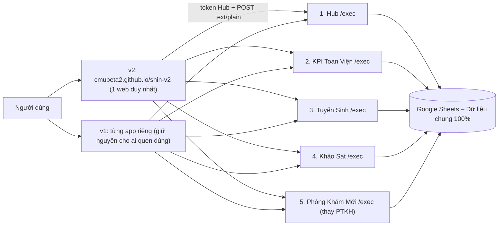

# KẾ HOẠCH SHIN v2 – 1 web gộp mọi module, dùng chung dữ liệu với v1

> [!IMPORTANT]
> **v1 giữ nguyên, không đụng giao diện.** v2 là một **cửa thứ 3**: 1 web duy nhất trên `cmubeta2.github.io`, gọi đúng các máy chủ Apps Script mà v1 đang dùng → **cùng dữ liệu, chỉ khác giao diện**. Người dùng chọn v1 hay v2 tùy thói quen.

## 1. Trả lời: ghép được không?
**Được và đã hoàn thành khởi tạo P0.** Theo đúng chỉ đạo của Sếp: **KHÔNG cần đem PTKH cũ qua, chỉ đem app PK mới qua**, giúp kiến trúc của v2 hoàn toàn tinh gọn, không còn nợ kỹ thuật 152 hàm cũ!

| Điều kiện | Hiện trạng & Kết nối v2 | Trạng thái |
|---|---|---|
| Đăng nhập chung | Token Hub `h1.<mã>.0.<ký>` được mọi app tự kiểm (cùng `HUB_KHOA`) | 1 token mở được mọi module ✅ |
| Cổng dữ liệu JSON | Hub (16 cổng `web*`), KPI (6), TS (8), KS (khảo sát), PK (phòng khám mới) | 5/5 App đều có cổng web doPost chuẩn ✅ |
| **Bỏ PTKH cũ** | **App PK mới (`21_PhongPTKH`) thay thế hoàn toàn PTKH trong v2** | Mã sạch, không nợ kỹ thuật ✅ |
| Trang trực tuyến | **cmubeta2.github.io/shin-v2** đã phát hành trực tiếp qua GitHub Pages | HTTP 200 Live ✅ |

## 2. Kiến trúc v2

- **Khung (shell):** thanh đầu + menu đáy ghim, 8 bộ màu, đúng `PHONG_CACH_APP_SHIN.md`.
- **Sổ module:** mỗi module = `{ma, ten, bieuTuong, app, cong[], manHinh}`. Thêm tính năng = thêm 1 tệp module, không sửa khung → đúng quy luật module anh đặt từ đầu.
- **Phân quyền:** khung hỏi Hub `webKhoiDong` → chỉ hiện module người đó được cấp (giữ nguyên quyền từng app).
- **Chế độ trình diễn:** mở github.io không có token → chạy **dữ liệu giả**, ai xem cũng được, không lộ gì. Có token → dữ liệu thật.
- **Phiên bản:** `v2.Y.Z` (Y = lần phát hành lên github.io, Z = lần sửa trong đợt) – theo quy ước 26/10, X = 2 do anh quyết.

## 3. Lộ trình
| Đợt | Nội dung | Kết quả nghiệm thu |
|---|---|---|
| **P0 – Nền** | Repo `shin-v2`, khung + sổ module, đăng nhập token, dữ liệu giả, đăng github.io; **thử gọi thẳng Hub /exec từ github.io** | Link github.io mở được, chế độ trình diễn chạy; token anh vào được Hub thật |
| **P1 – Module có sẵn cổng** | Hub (Hôm nay · Thông báo · Việc riêng · Điều hành 🧭), KPI (Bản tin · Soát lỗi · AOP · Báo cáo quý), TS (Chiến dịch · Lead) | Bảng đối chiếu v1↔v2 từng màn: cùng số liệu |
| **P2 – Cổng PTKH** | Thêm `webGoi` vào PTKH (chỉ thêm), kiểm thử PTKH cũ vẫn đạt đủ | `kiem_tra_tat_ca.js` PTKH đạt 100%, v1 không đổi |
| **P3 – Module PTKH** | Hôm nay · Báo cáo + minh chứng · Công việc · Tổng quan · Tôi · Lịch nghỉ / xếp lịch … (chia nhiều lượt) | Đối chiếu đủ 152 hàm → **ngang tính năng v1** |
| **P4 – KS, PK** | Theo nhịp v1 làm tới đâu, v2 có module tới đó | – |

## 4. An toàn khi đưa lên GitHub công khai
- Repo **chỉ chứa mã giao diện v2 + dữ liệu giả.** Không đưa: `20_PTKH`, thư mục minh chứng, `.env`, `.clasp.json`, id Sheet, file TV3, nhật ký AI.
- Link `/exec` sẽ thấy được trong mã (giống bản pages.dev hiện nay) – vẫn an toàn vì mọi cổng đòi token ký HMAC; không token chỉ nhận lỗi `quyen`.
- Thêm bước quét trước mỗi lần đẩy: chặn nếu thấy id Sheet / khóa / số điện thoại.

## 5. Sửa lại việc em làm lần trước
- Em đã **trả liên kết Obsidian `Shin_TriThuc` về chỗ cũ** (`Thiện Phúc Cloud\He sinh thai Shin\05_TriThuc`) – v1 chạy như cũ.
- Thư mục `My Drive\SHIN` hiện là **bản chép thừa của v1** (~340 MB, có cả `20_PTKH`). Đề xuất: dọn bản chép, dùng `SHIN` làm repo v2 sạch. **Chờ anh đồng ý mới xóa.**
- Các tệp README / UPDATE / KE_HOACH_TOAN_DIEN trong `SHIN` viết theo hướng "dời gốc" là sai ý anh → sẽ viết lại cho v2.

## 6. Câu cần anh chọn
| # | Câu | Mặc định em đề xuất |
|---|---|---|
| Q1 | Repo công khai (github.io miễn phí) hay riêng tư (cần GitHub Pro)? | **Công khai**, chỉ mã giao diện + dữ liệu giả |
| Q2 | v2 gọi thẳng `/exec` hay qua proxy Cloudflare (có đệm, ẩn link)? | **Gọi thẳng** (github.io không chạy proxy được); proxy để dự phòng nếu thử P0 lỗi |
| Q3 | Dọn bản chép v1 trong `My Drive\SHIN` và dùng làm repo v2? | **Có** |
| Q4 | Thứ tự: Hub + KPI + TS trước (có cổng sẵn), PTKH sau? | **Có** – PTKH cần mở cổng trước, làm ở P2–P3 |

> **Sếp 31/10 tối:** anh dùng **PTKH qua v2** → mở cổng `webGoi` (PTKH L148, tuần 1/11–7/11) thay cho ý "v2 bỏ PTKH cũ" ở mục 1. PK làm dần phần máy chủ sạch (chỉ cổng); Nghỉ & lịch tuần ghi qua cổng PTKH.
