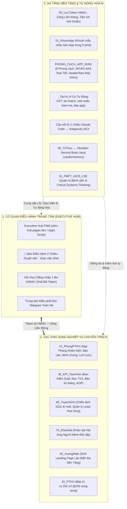
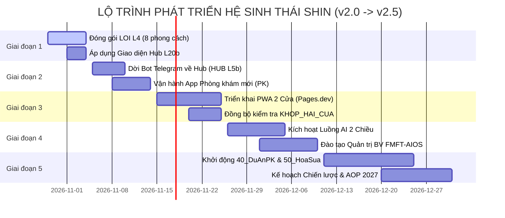

# BẢN KẾ HOẠCH CHIẾN LƯỢC TOÀN DIỆN: HỆ SINH THÁI SHIN (SHIN AIOS)

> [!IMPORTANT]
> **MỐC CHUYỂN GIAO LỊCH SỬ (MASTER ROOT GENESIS - 29/10/2026)**  
> Toàn bộ kiến trúc, mã nguồn Lõi, các App vệ tinh và hệ thống Tự động hóa của Hệ sinh thái SHIN đã được tách lập độc lập, làm sạch hoàn toàn và thiết lập chính thức tại thư mục gốc:  
> [SHIN Workspace Master](file:///D:/Hyrta-One/cmubeta2/My%20Drive/SHIN)  
> Kiểm thử toàn hệ thống đạt kết quả tuyệt đối: **385/385 ca kiểm thử đạt chuẩn (100%)**.

---

## 1. SƠ ĐỒ ĐIỀU HÀNH TỔNG THỂ HỆ SINH THÁI



---

## 2. MA TRẬN PHÂN TẦNG VÀ 6 TRỤ CỘT CỐT LÕI

| Trụ cột | Thư mục | Nền tảng | Trách nhiệm chính & Khả năng vận hành |
|---|---|---|---|
| **1. Hạ tầng Lõi** | `00_Loi`<br>`01_KhuonApp` | Node.js + Apps Script | Xác thực chữ ký HMAC-SHA256 không thời hạn, bộ tiện ích số VN/ngày tháng, khung kiểm thử tự động, nhân bản app mới trong 5 phút qua `dong_bo.js`. |
| **2. Bàn Điều hành Hub** | `10_Hub` | Cloudflare Pages + Apps Script | Bàn làm việc trung tâm gom việc toàn hệ, xem thẻ 3 số từng mảng, Tab 🧭 Điều hành 2 chiều (Sếp duyệt kế hoạch, giao việc trực tiếp cho Shin), trung tâm thông báo Telegram. |
| **3. Vận hành Y tế** | `21_PhongPTKH`<br>`20_PTKH`<br>`70_KhaoSat` | Pages PWA + Google Sheets | Báo cáo ngày kèm minh chứng ảnh, duyệt công việc, phân ca trực & xin nghỉ tuần, khảo sát sự hài lòng người bệnh (ACHSI) độc lập thời gian thực. *Tuyệt đối không can thiệp chuyên môn y khoa.* |
| **4. Kiểm soát Hiệu suất** | `30_KPI_ToanVien`<br>`31_FMFT_AIOS` | Apps Script (TV3 Read-only) | Ban Kiểm Soát theo dõi tiến độ mục tiêu doanh thu/lượt khám, xuất bản tin tháng, soát lỗi chốt quý, nháp báo cáo quý, xây dựng AOP 2027 từ dữ liệu tham chiếu AOP 2026. |
| **5. Tăng trưởng & Tuyển sinh**| `60_TuyenSinh`<br>`03_XuongWeb` | HTML Tailwind + Cloudflare | Vận hành các chiến dịch tuyển sinh đại học trực tuyến (GDU, SP Huế), tính hoa hồng bậc thang đại lý, xưởng sinh web tĩnh lặn biển đa nền tảng (Pages/Vercel/Netlify). |
| **6. Tự động hóa & Tri thức** | `_TacVu`<br>`05_TriThuc` | Python 3.12 + Obsidian | 4 ca làm việc tự động 24/7 (kế hoạch 10h57/22h57, viết code :27, kiểm tra 21h22/08h22, đưa app 09h52/16h52), cầu nối AI Claude ↔ Antigravity, liên thông Obsidian Second Brain. |

---

## 3. BẢNG TIÊU CHUẨN GIAO DIỆN PHONG_CACH_APP_SHIN (ĐÃ SẾP DUYỆT 29/10)

> [!NOTE]
> Bảng tiêu chuẩn này là **nguồn tham chiếu DUY NHẤT** cho toàn bộ các màn hình app mới trong hệ sinh thái Shin.

```
┌────────────────────────────────────────────────────────┐
│  [LOGO]  Phòng Khám Đa Khoa                [🔔:3] [🎨] │  ← HEADER ĐỈNH (Ghim 44px, Gradient)
├────────────────────────────────────────────────────────┤
│  ┌──────────────────────────────────────────────────┐  │
│  │ 👋 Chào buổi sáng, Sếp Tâm!                       │  │
│  │ 📅 T5, 29/10/2026                                │  │
│  │                                                  │  │
│  │  [  89%  ]     [   14   ]      [ 124,5 tr ]      │  │  ← HERO CARD (≤ 3 Ô SỐ + 1 NÚT CHÍNH)
│  │  Tiến độ tuần    Việc chờ duyệt   Doanh thu ngày │  │
│  │                                                  │  │
│  │  [ 🗂️ DUYỆT BÁO CÁO NGÀY (Nút chính 44px) ]      │  │
│  └──────────────────────────────────────────────────┘  │
│                                                        │
│  CẦN XỬ LÝ NGAY · 4                                    │  ← NHÃN NHÓM IN HOA
│  ┌──────────────────────────────────────────────────┐  │
│  │ [📋] Soát lỗi chốt quý III · BKS      [ 12 ] ›   │  │  ← DÒNG hn-dong (Bấm được, Chữ đậm, Số to)
│  └──────────────────────────────────────────────────┘  │
│  ┌──────────────────────────────────────────────────┐  │
│  │ [👥] Đổi ca trực Bs. Khoa Nhi         [ 14h ] ›   │  │
│  └──────────────────────────────────────────────────┘  │
│                                                        │
│  (Nội dung cuộn độc lập, đệm đáy padding-bottom: 96px) │
├────────────────────────────────────────────────────────┤
│   [🏠 Hôm nay]  [📝 Báo cáo]  [✅ Việc]  [📊 KPI]  [👤 Tôi]  │  ← MENU ĐÁY (Ghim 62px, Chấm đỏ thông báo)
└────────────────────────────────────────────────────────┘
```

### Quy tắc Thiết kế Bất biến:
1. **LUÔN GHIM THANH HEADER ĐỈNH VÀ THANH MENU ĐÁY:** Không bao giờ để nội dung che khuất menu điều hướng hoặc tiêu đề; nội dung cuộn mượt mà ở giữa.
2. **CẤM HOÀN TOÀN CUỘN NGANG:** Không cuộn ngang bảng trên điện thoại; tự động chuyển sang thẻ dòng `hn-dong` hoặc khối thẻ bảng số `hn-bang-so`.
3. **VÙNG BẤM TỐI THIỂU 44PX:** Mọi nút bấm, icon tròn, chip viên thuốc đều đạt kích thước bấm chuẩn công thái học.
4. **TỰ HIỂN NHIÊN & HOÀN TÁC 6S:** Bỏ mọi hộp thoại xác nhận gây ức chế. Thay vào đó là cơ chế bấm 2 lần cho việc nguy hiểm và thanh Toast đếm ngược hoàn tác 6 giây.
5. **MA TRẬN 8 PHONG CÁCH MÀU:**
   - *Hoàng Kim:* Vận hành PTKH & Hành chính.
   - *Executive Hub:* Bàn làm việc Sếp & Quản trị cấp cao.
   - *Clinical Precision:* Y tế & Khảo sát (WCAG AAA Teal 700 & Chữ phụ #335c57 trên nền trắng sáng).
   - *Fintech Growth:* Tuyển sinh & Bán hàng.
   - *Nordic Minimalist:* Kho tri thức & SOP cẩm nang.
   - *Cyber Terminal:* Giám sát hệ thống & Logs tác vụ.
   - *Crimson Authority:* Ban Kiểm Soát & Kỷ luật.
   - *Mocha Warmth:* Nhân sự & Lịch trực thân mật.

---

## 4. LỘ TRÌNH TRIỂN KHAI CHI TIẾT (5 GIAI ĐOẠN)



---

## 5. BẢNG THEO DÕI CÁC QUYẾT ĐỊNH CẦN SẾP DUYỆT

| Mã QĐ | Quyết định đề xuất | Phương án Shin khuyến nghị (A) | Phương án thay thế (B) |
|---|---|---|---|
| **QD-01** | **Xác nhận Master Root mới** | **DUYỆT:** Sử dụng `D:\Hyrta-One\cmubeta2\My Drive\SHIN` làm gốc duy nhất, lưu trữ thư mục cũ. | Giữ chạy song song 2 nơi. |
| **QD-02** | **Thứ tự thực hiện tuần này** | **DUYỆT:** Hoàn thiện `LOI L4` → Xuất bản `KS L1` (Khảo sát) → Xuất bản `PK L1` (Phòng khám mới). | Đẩy dời Bot Telegram lên làm trước. |
| **QD-03** | **Cấp quyền 4 trang Cloudflare Pages** | **ỦY QUYỀN:** Shin tạo sẵn tệp lệnh và mã nguồn; Sếp xác nhận 1 lần trên Cloudflare Dashboard. | Sếp tự tạo từng trang thủ công. |
| **QD-04** | **Kiểm tra Obsidian Second Brain** | **XÁC NHẬN:** Mở Obsidian kiểm tra liên kết `Wiki/Shin_TriThuc` đã trỏ vào Master Root. | Sếp điều chỉnh vị trí lưu trữ vault. |
