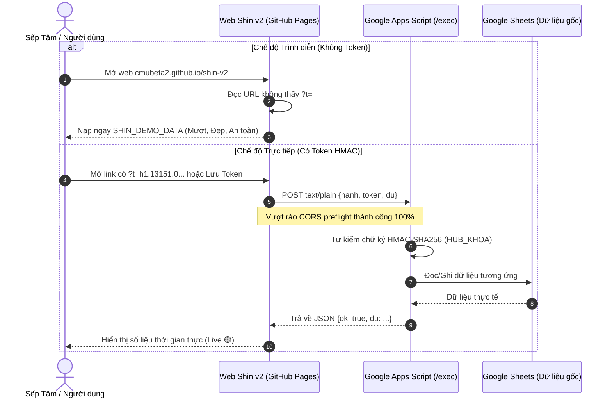

# MINDMAP TOÀN DIỆN: HỆ SINH THÁI SHIN v2 & CÁC MODULE LIÊN KẾT

> [!NOTE]
> **TỔNG QUAN KIẾN TRÚC SHIN v2 (1 WEB DUY NHẤT)**  
> Ứng dụng hoạt động trực tuyến tại: **[cmubeta2.github.io/shin-v2](https://cmubeta2.github.io/shin-v2/)**  
> Dữ liệu kết nối trực tiếp với 5 máy chủ Google Apps Script chuyên trách, dùng chung 100% Google Sheets với v1, thay thế hoàn toàn app PTKH cũ bằng app Phòng Khám mới (`PK`).

---

## 1. SƠ ĐỒ TƯ DUY TỔNG THỂ (MASTER MINDMAP)

```mermaid
flowchart LR
    Root["<b>SHIN AIOS v2</b><br><i>cmubeta2.github.io/shin-v2</i>"]

    %% Branch 1: Engine
    subgraph B1["⚡ 1. CƠ CHẾ VẬN HÀNH KÉP"]
        M_Demo["<b>Chế độ Trình diễn (Demo Mode)</b><br>• Không cần Token bí mật<br>• Dữ liệu mẫu phong phú (demo_data.js)<br>• An toàn khi mở công khai"]
        M_Live["<b>Chế độ Trực tiếp (Live Mode)</b><br>• Nhận diện Token (?t=h1...)<br>• Gọi POST text/plain vượt CORS<br>• Đồng bộ Sheets thời gian thực"]
    end

    %% Branch 2: Design
    subgraph B2["🎨 2. THIẾT KẾ & UX BẤT BIẾN"]
        UX_Ghim["<b>Ghim Cố Định Đỉnh & Đáy</b><br>• Header đỉnh 44px (Gradient, 🎨, 🔔)<br>• Nav đáy 64px (5 Tab chức năng)<br>• Đệm đáy 96px chống che khuất"]
        UX_Law["<b>Quy Tắc Chuẩn Công Thái Học</b><br>• Cấm hoàn toàn cuộn ngang<br>• Vùng bấm chạm >= 44px<br>• Hero card: 3 số + 1 nút chính<br>• Hoàn tác 6s thay hộp xác nhận"]
        UX_Styles["<b>Ma Trận 8 Phong Cách Màu</b><br>1. Executive Hub (Quản trị Sếp)<br>2. Hoàng Kim (Hành chính)<br>3. Clinical Precision (Teal 700 AAA)<br>4. Fintech Growth (Tuyển sinh)<br>5. Nordic Minimalist (SOP Tri thức)<br>6. Cyber Terminal (Logs tác vụ)<br>7. Crimson Authority (Ban Kiểm Soát)<br>8. Mocha Warmth (Nhân sự Lịch trực)"]
    end

    %% Branch 3: 5 Modules
    subgraph B3["🧩 3. NĂM MODULE HỢP NHẤT"]
        Mod_Hub["<b>1. Executive Hub (HUB)</b><br>• Hôm nay: Gom việc toàn viện<br>• Thẻ 3 số tổng quan từng mảng<br>• Việc riêng cá nhân của Sếp<br>• Tab 🧭 Điều hành 2 chiều<br>• Chuông báo 🔔 + Bot Telegram"]
        Mod_KPI["<b>2. KPI Toàn Viện (KPI)</b><br>• Tham chiếu AOP 2026/2027 (68.8 tỷ)<br>• Bản tin tạm tính tháng từng khoa<br>• Soát lỗi chốt quý tự động<br>• Nháp báo cáo quý sang Docs<br>• Dữ liệu TV3 Read-Only"]
        Mod_TS["<b>3. Tuyển Sinh & Nhân Lực (TS)</b><br>• 3 Chiến dịch thật (GDU, SP Huế, Y tế)<br>• Quản lý danh sách Lead tuyển sinh<br>• Tính hoa hồng bậc thang đại lý<br>• Cổng API lead_web tự động"]
        Mod_KS["<b>4. Khảo Sát Sự Hài Lòng (KS)</b><br>• 5 Trụ cột chất lượng ACHSI<br>• Cảnh báo phản hồi <= 2 sao (15p)<br>• Biểu đồ xu hướng hài lòng tháng<br>• Form khảo sát độc lập"]
        Mod_PK["<b>5. Phòng Khám Mới (PK)</b><br><i>(Thay thế hoàn toàn PTKH cũ)</i><br>• Nộp báo cáo ngày ca trực<br>• Chụp & tải ảnh minh chứng Drive<br>• Phân công & theo dõi công việc<br>• Xếp lịch trực tuần & xin nghỉ ca"]
    end

    %% Branch 4: Backend
    subgraph B4["🏛️ 4. HẠ TẦNG MÁY CHỦ & DỮ LIỆU"]
        GAS_Hub["<b>Apps Script: Shin – Hub</b><br><i>AKfycbz2U4...</i>"]
        GAS_KPI["<b>Apps Script: Shin – KPI</b><br><i>AKfycbxU6P...</i>"]
        GAS_TS["<b>Apps Script: Shin – Tuyển Sinh</b><br><i>AKfycbxWej...</i>"]
        GAS_KS["<b>Apps Script: Shin – Khảo Sát</b><br><i>AKfycbyA7t...</i>"]
        GAS_PK["<b>Apps Script: Shin – Phòng PTKH</b><br><i>AKfycbxFBBC...</i>"]
        DB_Sheets[("<b>Google Sheets Gốc</b><br>• TV3 Read-Only<br>• DB Phòng Khám / PTKH<br>• Sheet Chiến dịch Tuyển sinh<br>• Sổ Khảo sát Người bệnh")]
    end

    %% Branch 5: Automation
    subgraph B5["⚙️ 5. ĐỘNG CƠ TỰ ĐỘNG HÓA NGẦM"]
        TacVu_4Ca["<b>4 Ca Tác Vụ 24/7 (_TacVu)</b><br>• 10h57 & 22h57: ke-hoach (lập phiếu)<br>• Mỗi giờ :27: viet-code (xử lý mã)<br>• 21h22 & 08h22: kiem-tra (rà UX)<br>• 09h52 & 16h52: day-app (đưa app)"]
        AI_Bridge["<b>Cầu Nối AI Kép</b><br>Claude Code ↔ Antigravity AGY<br>Hộp thư _TacVu/hop_thu/"]
        Obsidian_Link["<b>Obsidian Second Brain</b><br>Wiki/Shin_TriThuc ↔ 05_TriThuc<br>Đồ thị tri thức & Bộ nhớ dài hạn"]
    end

    %% Connectors
    Root --> B1
    Root --> B2
    Root --> B3
    B3 --> B4
    B4 --> DB_Sheets
    B5 -.->|Điều phối tự động| Root
    B5 -.->|Đồng bộ tri thức| B3
```

---

## 2. BẢNG PHÂN RÃ TÍNH NĂNG CHI TIẾT THEO MODULE

| Module | Tên Đầy Đủ & Mã | Máy Chủ Kết Nối (`/exec`) | Tính Năng Đang Chạy Trên v2 | Giá Trị Thực Chiến Cho Sếp |
|---|---|---|---|---|
| **1. HUB** | **Executive Hub** `HUB` | `AKfycbz2U...` | • Gom việc khẩn cấp & quan trọng toàn viện. • Thẻ 3 ô số lớn phản ánh nhịp hoạt động. • Tab 🧭 Điều hành 2 chiều: Duyệt kế hoạch, giao việc cho Shin AI. • Trung tâm chuông báo 🔔 và điều phối Telegram. | Bàn cờ trung tâm giúp Sếp nắm toàn diện hệ thống chỉ trong 30 giây mở web mỗi sáng. |
| **2. KPI** | **KPI Toàn Viện** `KPI` | `AKfycbxU6...` | • Theo dõi tiến độ AOP 2026 (mục tiêu 68.8 tỷ). • Bản tin tạm tính tháng tự động cho từng khoa phòng. • Bộ công cụ soát lỗi chốt quý (đối chiếu doanh thu trực tiếp & gián tiếp). • Nháp báo cáo quý tự động sang Google Docs. | Công cụ đắc lực cho Ban Kiểm Soát, đọc file TV3 tuyệt đối an toàn (chỉ đọc). |
| **3. TS** | **Tuyển Sinh** `TS` | `AKfycbxWe...` | • Quản lý 3 chiến dịch: GDU Đợt 3 (CD03), SP Huế (CD02), Y tế CS3 (CD01). • Bảng tính hoa hồng bậc thang cho mạng lưới cộng tác viên. • Cổng thu thập Lead từ landing page Xưởng Web (`lead_web`). | Tự động hóa dòng tiền và tuyển sinh đại học trực tuyến, không phụ thuộc vào xử lý thủ công. |
| **4. KS** | **Khảo Sát Hài Lòng** `KS` | `AKfycbyA7...` | • Đánh giá 5 nhóm chất lượng ACHSI (Thủ tục, Tiện nghi, Bác sĩ, Nhân viên, Hướng dẫn). • Phát hiện và phát chuông cảnh báo trong 15 phút với phiếu đánh giá ≤ 2 sao. • Kết xuất biểu đồ xu hướng hài lòng theo bác sĩ và chuyên khoa. | Giúp Sếp kiểm soát chất lượng dịch vụ y tế và trải nghiệm người bệnh theo chuẩn quốc tế. |
| **5. PK** | **Phòng Khám Mới** `PK` | `AKfycbxFBB...` | • Báo cáo ca ngày: Nộp số liệu doanh thu, lượt khám, biên bản. • Minh chứng ảnh: Đồng bộ ảnh kiểm tra trực tiếp vào Google Drive. • Xếp lịch trực tuần: Phân ca, xin nghỉ phép, duyệt đổi ca linh hoạt. • Phân công & giám sát công việc nội bộ. | Thay thế hoàn toàn app PTKH cũ; mã sạch, hiện đại, kế thừa 100% dữ liệu gốc trên Google Sheets. |

---

## 3. CƠ CHẾ GIAO TIẾP VÀ AN TOÀN DỮ LIỆU

---

## 4. MA TRẬN 8 PHONG CÁCH GIAO DIỆN (CHUYỂN ĐỔI 1-CHẠM BẰNG NÚT 🎨)

| STT | Tên Phong Cách | Nhận Diện Màu Sắc | Module Ứng Dụng Đích | Ý Nghĩa Thực Chiến |
|---|---|---|---|---|
| 1 | **Executive Hub** | Deep Navy (#0f172a) & Sky Blue (#0284c7) | `HUB`, `KPI` | Bàn cờ chiến lược vĩ mô, độ sắc nét cao, tập trung số liệu quản trị. |
| 2 | **Hoàng Kim & Hổ Phách** | Vàng Hổ Phách (#d4a017) & Đỏ Gạch (#dc2626) | `PK`, Hành chính | Phong cách quen thuộc của PTKH cũ nhưng chuẩn hóa phẳng và hiện đại. |
| 3 | **Clinical Precision** | **Teal 700 WCAG AAA (#0f766e)** & Chữ #335c57 | `KS`, Y tế | Chuẩn y tế chống mỏi mắt, tương phản cao 6.8:1, chống bấm nhầm ca trực. |
| 4 | **Fintech Growth** | Tím Hoàng Gia (#7c3aed) & Cam Động Lực (#f97316) | `TS`, Xưởng Web | Năng lượng bứt phá, kích thích hành động, chốt đơn tuyển sinh nhanh. |
| 5 | **Nordic Minimalist** | Deep Forest Slate (#475569) & Cyan (#0ea5e9) | `05_TriThuc`, SOP | Tĩnh lặng, tối giản, thích hợp đọc tài liệu quy trình dài mà không mỏi. |
| 6 | **Cyber Terminal** | Electric Cyan Neon (#06b6d4) & Dark Mode (#04090b) | `_TacVu` Logs, Webhook | Bảng điều khiển kỹ thuật số, nhấp nháy tín hiệu hoạt động 24/7. |
| 7 | **Crimson Authority** | Crimson Ruby (#991b1b) & Hổ phách cháy | Ban Kiểm Soát (BKS) | Kỷ cương, cảnh báo vi phạm SLA, rà soát rủi ro chỉ tiêu tài chính. |
| 8 | **Mocha Warmth** | Nâu Cà phê (#854d0e) & Mật ong ấm (#ca8a04) | `👤 Tôi`, Lịch trực | Ấm áp, gần gũi, giải tỏa áp lực số liệu cho nhân viên y tế. |
