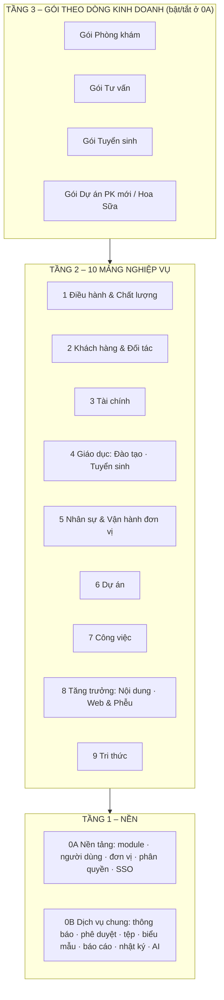

# PHẢN BIỆN CẤU TRÚC 10 MẢNG – ĐỀ XUẤT ĐIỀU CHỈNH

## 0. Đính chính trước
Bản quy hoạch và danh mục module em gửi trước đó **có ghi nhiều module như đã có, nhưng thực ra chưa có mã**: phê duyệt 1-chạm, radar khảo sát 15 phút, LMS, Task Bus, tự đăng bài, Daily Flash, toàn bộ mảng Tư vấn. Bản này có thêm cột **Hiện trạng** để anh biết module nào chạy thật, module nào mới là ý tưởng.

---

## 1. Đánh giá chung
**Điểm đúng:** chia theo năng lực, có một "hạt nhân" riêng (mảng 0), Tri thức và Công việc là trục chung cho mọi mảng.

**6 vấn đề chính:**

| # | Vấn đề | Hệ quả nếu giữ nguyên |
|---|---|---|
| 1 | **Thiếu Khách hàng & Đối tác.** Học viên, CTV, trường đối tác, khách tư vấn, nhà cung cấp đang nằm rải ở mảng 3, 2 và 8 | Cùng 1 người có thể bị lưu ở 3 nơi, không ai thấy được toàn bộ lịch sử giao dịch với họ |
| 2 | **Thiếu Tài chính.** Học phí, hoa hồng, chi phí dự án, VietQR, đối soát SePay rải ở mảng 3, 5 và 8 | Không có 1 sổ thu chi chung; hoa hồng và chi phát sinh không đối chiếu được với nhau |
| 3 | **2 app đang có chưa có chỗ:** KPI toàn viện (BKS) và Khảo sát | Quy hoạch không khớp với hệ đang chạy |
| 4 | **Trùng chức năng** ở lead, thanh toán, phê duyệt, việc, báo cáo (chi tiết ở mục 3) | Mỗi mảng tự làm 1 bản riêng, lệch dữ liệu, tốn công làm lại |
| 5 | **Lẫn "dòng kinh doanh" với "năng lực".** Tư vấn là một dòng kinh doanh, ghép từ CRM + Dự án + Tri thức + khảo sát chẩn đoán | Thành 1 mảng rỗng, toàn module trùng với mảng khác |
| 6 | **AI gắn vào Điều hành**, trong khi Marketing, Tri thức, Tư vấn, Tác vụ đều dùng AI | AI là năng lực dùng chung, phải nằm ở tầng nền |

---

## 2. Còn thiếu – đề xuất thêm

### 2.1 Khách hàng & Đối tác (CRM) – mảng mới, ưu tiên cao
| Module | Nội dung |
|---|---|
| Danh bạ hợp nhất | 1 hồ sơ cho mỗi người / tổ chức, gắn nhiều vai trò: khách hàng DN, học viên, CTV/đại lý, trường đối tác, nhà cung cấp, đối tác truyền thông |
| Lead & pipeline chung | Mọi lead (web, CTV, giới thiệu) vào 1 nơi; mỗi dòng kinh doanh có các bước pipeline riêng (Tuyển sinh, Tư vấn, Khám VIP) |
| Lịch sử tương tác | Gọi, Zalo, gặp, gửi báo giá – theo dòng thời gian |
| Hợp đồng & cam kết | Hợp đồng đối tác (VD: HĐ TP – PK Đầm Dơi, TPT), hạn gia hạn, điều khoản hoa hồng |
| Chống trùng | Trùng SĐT / mã số thuế thì gộp hồ sơ (dùng lại luật chống trùng của TS L3) |

> [!CAUTION]
> **Người bệnh không đưa vào CRM.** Hồ sơ bệnh án nằm ở hệ thống của viện. SHIN chỉ giữ thông tin liên hệ của lead đặt lịch, và chỉ khi anh duyệt (khớp `KHONG_DUA_VAO.md`).

### 2.2 Tài chính – mảng mới
Sổ thu chi theo dòng kinh doanh / dự án · Cổng thu VietQR + đối soát SePay · Hoa hồng & công nợ đối tác (lấy từ CRM) · Ngân sách – thực chi – phát sinh (Dự án dùng lại) · Báo cáo dòng tiền.

### 2.3 Chất lượng & Hiệu suất – chỗ cho KPI và Khảo sát
KPI toàn viện (BKS) · Bảng điểm cá nhân / tổ · Khảo sát hài lòng · Chỉ số chất lượng ACHSI. *Có thể đặt trong mảng Điều hành; xem câu Q3.*

---

## 3. Bị trùng – đề xuất ghép

| Chức năng | Đang nằm ở | Ghép về | Mảng khác chỉ làm gì |
|---|---|---|---|
| **Lead / pipeline** | 3.2, 8.3, 2 | **CRM** | Web chỉ thu lead rồi đẩy sang CRM; Tuyển sinh chỉ cấu hình các bước pipeline riêng |
| **Thanh toán VietQR** | 3.5, 8.5 | **Tài chính** (cổng thu dùng chung) | Web / Tuyển sinh nhúng nút thanh toán |
| **Phê duyệt** | 1.2, 5.5, 4.3, PTKH duyệt 2 cấp | **Dịch vụ Phê duyệt** dùng chung | Hub chỉ là hộp duyệt; mỗi mảng gửi yêu cầu theo 1 mẫu |
| **Việc** | 1.1, 6, 4 (phân công ca), 5 | **Công việc** (mảng 6) là nơi duy nhất ghi việc | Hub chỉ hiển thị; mảng khác tạo việc qua 1 cổng chung |
| **Báo cáo định kỳ** | Báo cáo ca (PK), Daily Flash (Dự án), báo cáo ngày PTKH | **1 máy báo cáo theo mẫu** | Mỗi mảng chỉ định nghĩa mẫu: 4 khối cho Dự án, mẫu ca trực cho PK |
| **Marketing + Web & Phễu** | 7, 8 | **1 mảng "Tăng trưởng"** gồm 2 nhóm: Nội dung · Web & Phễu | Web là một kênh của marketing; tách 2 mảng thì phễu và nội dung lệch nhau |
| **Hồ sơ / danh bạ nhân sự** | 4.1, Hub danh bạ, M0.3 | **Danh tính** ở tầng nền | Nhân sự chỉ thêm phần hợp đồng lao động, chức danh, ca |

---

## 4. Phức tạp – đề xuất tách

| Mảng | Vì sao tách | Tách thành |
|---|---|---|
| **0 – Quản lý module** | Đang ôm 4 việc khác loại nhau | **0A Nền tảng** (module, phiên bản, người dùng, đơn vị, phân quyền, SSO) · **0B Dịch vụ dùng chung** (thông báo, phê duyệt, tệp & minh chứng, biểu mẫu, máy báo cáo, nhật ký, cổng AI) |
| **3 – Giáo dục** | Đào tạo và Tuyển sinh khác hẳn nhau: Tuyển sinh là bán hàng hưởng hoa hồng cho trường đối tác | 2 nhóm trong cùng mảng: **Đào tạo** (lớp, bài, chứng nhận, FMFT nội bộ) · **Tuyển sinh** (chiến dịch + pipeline của CRM + hoa hồng của Tài chính) |
| **4 – Nhân sự** | Lẫn hồ sơ nhân sự với vận hành khoa/phòng | **Nhân sự** (lịch trực, nghỉ, TC-NS, NTC, cảm nhận ngày) · **Vận hành đơn vị** (báo cáo ngày, minh chứng – phần app PK làm) |
| **1 – Điều hành & AI** | AI là năng lực dùng chung | Điều hành giữ Hub, hộp duyệt, báo cáo tổng hợp, 🧭; **AI chuyển về 0B** (định tuyến Claude/AGY, chi phí, nhật ký) |
| **Khảo sát** (app KS) | Vừa là công cụ, vừa là nghiệp vụ | Phần tạo/điền form → **0B Biểu mẫu** (Tư vấn chẩn đoán, Đào tạo đánh giá khóa, Marketing đều dùng) · Bộ khảo sát hài lòng ACHSI → Chất lượng |

---

## 5. Cấu trúc đề xuất (3 tầng)

**Thay đổi so với bản của anh:** thêm **CRM (2)** và **Tài chính (3)** · ghép Marketing + Web thành **Tăng trưởng (8)** · **Tư vấn** chuyển từ mảng thành **gói** ở tầng 3 · KPI và Khảo sát vào **Điều hành & Chất lượng (1)** · AI và các dịch vụ dùng chung xuống **0B**.

### Hiện trạng từng mảng
| Mảng | Đã có (chạy thật) | Có một phần | Chưa có |
|---|---|---|---|
| 0A Nền tảng | Token SSO HMAC, danh bạ Hub, đánh số phiên bản v1.Y.Z | Phân quyền (mỗi app tự giữ) | Bật/tắt module tập trung |
| 0B Dịch vụ chung | Thông báo (🔔 + Telegram qua Hub), tác vụ AI 4 ca | Phê duyệt (mỗi app tự làm), tệp minh chứng (PTKH) | Máy báo cáo theo mẫu, cổng AI |
| 1 Điều hành & Chất lượng | Hub, 🧭 Điều hành 2 chiều, KPI toàn viện (bản tin, soát lỗi, AOP, báo cáo quý) | Khảo sát (KS mới ở khung; khảo sát cũ nằm trong PTKH) | Hộp duyệt chung |
| 2 Khách hàng & Đối tác | – | Lead + chống trùng (trong TS) | Danh bạ hợp nhất, hợp đồng |
| 3 Tài chính | – | Bậc hoa hồng (sheet TS), STK/QR trên web | Sổ thu chi, đối soát SePay |
| 4 Giáo dục | Tuyển sinh (3 chiến dịch, lead web) | Tài liệu FMFT (văn bản, chưa có app) | LMS |
| 5 Nhân sự & Vận hành | PTKH: báo cáo + minh chứng, công việc, lịch nghỉ / xếp lịch, TC-NS, NTC, cảm nhận ngày | PK (khung, thay PTKH) | – |
| 6 Dự án | – | – | Toàn bộ, gồm Daily Flash 4 khối |
| 7 Công việc | Việc trong PTKH, việc riêng Hub | Hub gom việc qua cổng `viec` | Trục việc chung giữa các mảng |
| 8 Tăng trưởng | Xưởng web (mẫu phễu lặn biển, máy sinh web) | – | Marketing nội dung + duyệt bài |
| 9 Tri thức | `05_TriThuc` + Obsidian | – | Tự trích tri thức từ báo cáo |

---

## 6. Câu cần anh chọn
| # | Câu | Em đề xuất |
|---|---|---|
| Q1 | Thêm mảng **Khách hàng & Đối tác** và **Tài chính**? | **Có** – đây là 2 chỗ trống lớn nhất |
| Q2 | Ghép Marketing + Web thành **Tăng trưởng**? | **Có** (để có chỗ cho Tài chính mà vẫn giữ 0–9) |
| Q3 | **Tư vấn** chuyển thành "gói" ghép từ module, hay giữ thành mảng riêng? | **Gói.** Nếu anh muốn giữ thành mảng thì gộp KPI + Khảo sát vào Điều hành, và Tài chính chiếm số 3 |
| Q4 | Tách mảng 0 thành **0A Nền tảng / 0B Dịch vụ chung**, đưa AI xuống 0B? | **Có** |
| Q5 | Thứ tự làm sau khi chốt | **Dịch vụ chung 0B (phê duyệt, máy báo cáo, việc) → CRM → Dự án (Daily Flash) → Tài chính** – vì cái sau dùng lại cái trước |
