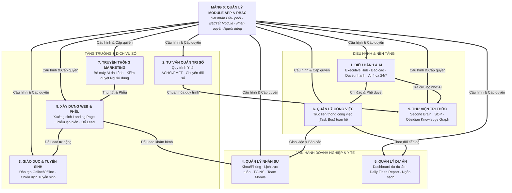

# BẢN QUY HOẠCH TOÀN DIỆN 10 MẢNG CHIẾN LƯỢC – HỆ SINH THÁI SHIN AIOS

> [!IMPORTANT]
> **TẦM NHÌN QUY HOẠCH HỆ THỐNG (CHỈ ĐẠO CỦA SẾP HUỲNH TRƯỜNG THANH TÂM):**  
> Hệ sinh thái SHIN được quy hoạch thành **10 Mảng Chiến Lược (Thập Diện Kiến Trúc - Decagon Architecture)**. Trong đó:  
> • **Mảng 0** đóng vai trò là **Hạt nhân Điều phối & Quản lý Module** (Kernel / Registry) điều khiển bật/tắt và phân quyền cho toàn hệ thống.  
> • **9 Mảng Nghiệp vụ (1 đến 9)** vận hành như các khối Lego độc lập, liên thông công việc, dữ liệu và tri thức với nhau qua hợp đồng I/O chuẩn mực.

---

## 1. SƠ ĐỒ THẬP DIỆN KIẾN TRÚC TOÀN HỆ SHIN (DECAGON ARCHITECTURE)



---

## 2. BẢNG PHÂN RÃ CHI TIẾT 10 MẢNG CHIẾN LƯỢC

### ⚙️ MẢNG 0: QUẢN LÝ MODULE APP & PHÂN QUYỀN (KERNEL REGISTRY)
*Cơ quan đầu não kiểm soát cấu trúc hệ điều hành: Bật/tắt module linh hoạt, cấu hình gói tính năng và phân quyền người dùng.*

| Mã Module | Tên Module Tính Năng | Input (Đầu vào) | Logic Xử Lý Cốt Lõi | Output (Đầu ra) | Ứng Dụng Thực Chiến |
|---|---|---|---|---|---|
| **M0.1** | **Bộ Điều Khiển Bật/Tắt Module (Feature Flags)** | Lệnh từ Sếp (Bật/Tắt module M1–M9) | Cập nhật cấu hình cờ tính năng động; ẩn/hiện module trên giao diện web v2 ngay lập tức mà không cần build lại mã | Trạng thái hiển thị giao diện theo thời gian thực | Khi triển khai cho phòng khám mới, chỉ cần bật M1, M4, M6; tắt tạm các mảng chưa dùng. |
| **M0.2** | **Ma Trận Phân Quyền Người Dùng (RBAC)** | Mã người dùng (`MaNV`), Danh sách quyền (Xem / Sửa / Duyệt) | Tra cứu bảng phân quyền theo Vai trò x Khoa/Phòng x Module; lọc sạch dữ liệu trước khi trả về | Danh mục tính năng và dữ liệu người dùng được phép thấy | Bác sĩ chỉ thấy Lịch trực và Báo cáo ca; Sếp và Ban Kiểm Soát thấy toàn bộ 10 mảng. |
| **M0.3** | **Cổng Cấp Token SSO & Khóa HMAC** | Khóa bí mật `HUB_KHOA`, Danh bạ nhân viên | Sinh và xác thực token chữ ký điện tử `h1.<ma>.0.<chuKy>` không thời hạn; tự hủy khi đổi khóa | Link đăng nhập sâu 1-lần cho toàn bộ 10 mảng | Người dùng chỉ cần 1 link duy nhất để mở mọi module trong hệ sinh thái. |
| **M0.4** | **Giám Sát Tải & Sức Khỏe Module (Telemetry)** | Nhật ký gọi cổng (API logs), Tần suất sử dụng | Đo lường thời gian phản hồi (Latency), phát hiện cổng quá tải hoặc lỗi kết nối máy chủ | Bảng trạng thái sức khỏe hệ thống (System Status Pill) | Báo động sớm khi Google Apps Script chạm ngưỡng giới hạn thời gian chạy. |

---

### 🏢 MẢNG 1: ĐIỀU HÀNH & AI (EXECUTIVE HUB)
*Trung tâm chỉ huy tối cao dành cho Sếp: Nắm bắt toàn diện, phê duyệt tức thì và trợ lực tự động hóa 24/7.*

| Mã Module | Tên Module Tính Năng | Input (Đầu vào) | Logic Xử Lý Cốt Lõi | Output (Đầu ra) | Ứng Dụng Thực Chiến |
|---|---|---|---|---|---|
| **M1.1** | **Bàn Làm Việc Điều Hành & Thẻ 3 Số** | Dữ liệu gom từ 9 mảng nghiệp vụ | Tính toán 3 chỉ số then chốt theo thời gian thực (Việc cần làm, Chờ duyệt, Cảnh báo); hiển thị Hero Card | Bàn cờ chiến lược tổng quan cho Sếp | Mở app 30 giây mỗi sáng là nắm trọn tình hình toàn viện và các đơn vị kinh doanh. |
| **M1.2** | **Động Cơ Phê Duyệt Nhanh 1-Chạm (Quick Approval)** | Yêu cầu duyệt từ các mảng (Báo cáo ca, Đổi ca trực, Chi phí dự án, Đề xuất kế hoạch) | Hiển thị tóm tắt cốt lõi 3 dòng; 1 chạm **"Đồng ý"** hoặc **"Yêu cầu sửa"** kèm ghi chú giọng nói/chữ | Quyết định được ký số và gửi ngược lại module phát sinh | Xóa bỏ hoàn toàn tình trạng tắc nghẽn hồ sơ chờ Sếp ký giấy. |
| **M1.3** | **Bàn Điều Hành 2 Chiều 🧭** | Quyết định của Sếp (`Dxx`, `Qxx`), Lệnh giao việc cho Shin AI | Phân loại lệnh; ghi biên bản vào `QUYET_DINH.md`; đẩy thẳng vào hàng đợi sản xuất của các ca tác vụ | Phản hồi tiến độ 3 bước: *Đã gửi ➔ Đã nhận ➔ Đã xong* | Sếp điều hành bộ máy kỹ thuật số trực tiếp trên web bằng ngôn ngữ tự nhiên. |
| **M1.4** | **Trung Tâm Bot Telegram Điều Phối** | Sự kiện khẩn từ toàn hệ thống (`suKien`) | Lọc mức độ ưu tiên: chỉ việc khẩn cấp (`muc:'gap'`) mới kích hoạt thông báo đẩy Telegram cá nhân hóa | Tin nhắn đẩy tức thì kèm nút bấm xử lý nhanh trên Telegram | Báo động ngay lập tức khi phát sinh sự cố y tế hoặc doanh thu có dấu hiệu trượt sâu. |
| **M1.5** | **Động Cơ Tự Động Hóa AI 4 Ca 24/7** | Hàng đợi công việc Lxx, Phiếu kế hoạch | Vận hành 4 ca liên hoàn: Kế hoạch (10h57/22h57) ➔ Viết code (:27) ➔ Kiểm tra UX (21h22/08h22) ➔ Đưa app (09h52/16h52) | Hệ thống tự cải tiến và sửa lỗi liên tục ngày đêm | Bộ máy kỹ thuật số không bao giờ ngủ, tối ưu hóa năng suất cho Sếp. |

---

### 💼 MẢNG 2: TƯ VẤN QUẢN TRỊ SỐ (DIGITAL CONSULTING)
*Đóng gói năng lực tư vấn chuyên sâu của Sếp: Quản trị y tế chuẩn ACHSI/FMFT, tái cấu trúc quy trình và chuyển đổi số doanh nghiệp.*

| Mã Module | Tên Module Tính Năng | Input (Đầu vào) | Logic Xử Lý Cốt Lõi | Output (Đầu ra) | Ứng Dụng Thực Chiến |
|---|---|---|---|---|---|
| **M2.1** | **Bộ Khảo Sát & Chẩn Đoán Sức Khỏe Quy Trình** | Dữ liệu thời gian chờ, Tỷ lệ lỗi, Ý kiến nhân sự | Phân tích nút thắt cổ chai (Bottleneck analysis), đo lường mức độ lãng phí thời gian và chi phí | Báo cáo chẩn đoán vận hành kèm điểm xếp hạng trưởng thành số | Dùng khi Sếp đi tư vấn chiến lược cho các bệnh viện hoặc phòng khám đối tác. |
| **M2.2** | **Khung Chuẩn Hóa SOP Y Tế & Doanh Nghiệp** | Quy trình thô của đơn vị đối tác | Áp dụng khung FMFT-AIOS: phân rã thành các bước chuẩn hóa, gán trách nhiệm RACI và tiêu chí nghiệm thu DoD | Bộ tài liệu quy trình chuẩn (SOP Toolkit) sẵn sàng ban hành | Tối ưu hóa quy trình khám ngoại trú, trải nghiệm người bệnh theo chuẩn ACHSI. |
| **M2.3** | **Đóng Gói Gói Giải Pháp Tư Vấn (Consulting Offer Stack)** | Nhu cầu của khách hàng doanh nghiệp | Cấu hình thang giá trị (Value Ladder): từ Chẩn đoán sơ bộ ➔ Đào tạo chuyên đề ➔ Chuyển giao hệ điều hành AIOS | Bảng đề xuất dịch vụ (Proposal) thuyết phục không thể từ chối | Thương mại hóa chuyên môn tư vấn doanh nghiệp của Sếp. |
| **M2.4** | **Lộ Trình Triển Khai Chuyển Đổi Số (Roadmap)** | Quy mô nhân sự, Ngân sách đối tác | Lập kế hoạch phân kỳ 3 giai đoạn: *Nền tảng ➔ Tự động hóa ➔ Tối ưu hóa AI* | Lộ trình WBS chi tiết kèm ma trận kiểm soát rủi ro | Giúp khách hàng nhìn rõ từng bước đi thực tế, data-driven, không sáo rỗng. |

---

### 🎓 MẢNG 3: GIÁO DỤC & TUYỂN SINH (EDUCATION & ADMISSIONS)
*Hệ thống đào tạo toàn diện (Online LMS & Offline) kết hợp cỗ máy tuyển sinh tự động hóa dòng tiền.*

| Mã Module | Tên Module Tính Năng | Input (Đầu vào) | Logic Xử Lý Cốt Lõi | Output (Đầu ra) | Ứng Dụng Thực Chiến |
|---|---|---|---|---|---|
| **M3.1** | **Quản Trị Chiến Dịch Tuyển Sinh** | Mã chiến dịch (`CD01`, `CD02`, `CD03`), Trường, Đợt tuyển | Cấu hình thông tin trường, ngành đào tạo, chỉ tiêu và hạn nộp hồ sơ; reset chu kỳ theo đợt | Hồ sơ chiến dịch tuyển sinh hoạt động trên hệ thống | Quản trị tuyển sinh Đại học Gia Định (GDU), ĐH Sư phạm Huế và các chứng chỉ y tế. |
| **M3.2** | **Quản Lý Vòng Đời Lead Tuyển Sinh (Pipeline CRM)** | Dữ liệu ứng viên từ Form Web / CTV | Quản lý luồng 5 bước: *Mới nhận ➔ Đang tư vấn ➔ Đã nộp hồ sơ ➔ Nhập học ➔ Hủy* | Bảng Kanban theo dõi học viên và tỷ lệ chốt đơn của tư vấn viên | Giúp đội ngũ tuyển sinh không bỏ sót bất kỳ học viên tiềm năng nào. |
| **M3.3** | **Bảng Tính Hoa Hồng Bậc Thang Lũy Tiến** | Số lượng học viên nhập học thực tế | Tự động áp biểu phí hoa hồng 6 bậc (Bậc 1: 1.5tr ➔ Bậc 6: 3.5tr/học viên); đối soát minh bạch | Bảng tổng hợp công nợ chi trả hoa hồng đại lý | Kích thích mạng lưới CTV và đại lý tuyển sinh hành động quyết liệt. |
| **M3.4** | **Cổng Quản Trị Đào Tạo (LMS Mini)** | Danh sách học viên, Giáo trình đào tạo | Quản lý lớp học (Online/Offline), điểm danh, giao và chấm bộ bài tập M01–M20 Quản trị Bệnh viện | Bảng điểm quá trình và cấp chứng nhận hoàn thành khóa học | Vận hành chương trình đào tạo FMFT-AIOS cho đội ngũ y tế Thanh Vũ Medic. |
| **M3.5** | **Thu Phí & Lệ Phí Tự Động (VietQR SePay)** | Mã hồ sơ, Số tiền học phí/lệ phí | Sinh mã QR động Napas 24/7; webhook SePay tự động xác nhận đơn trong 3 giây | Trạng thái "Đã đóng phí" được kích hoạt tự động, gửi biên lai tức thì | Xóa bỏ việc kiểm tra sao kê ngân hàng thủ công. |

---

### 👥 MẢNG 4: QUẢN LÝ NHÂN SỰ KHOA / PHÒNG (HR & CLINICAL WORKFORCE)
*Kế thừa tinh hoa từ app PTKH và chuẩn hóa trên app PK mới: Quản lý nhân sự, ca trực, chấm công và sức khỏe tinh thần.*

| Mã Module | Tên Module Tính Năng | Input (Đầu vào) | Logic Xử Lý Cốt Lõi | Output (Đầu ra) | Ứng Dụng Thực Chiến |
|---|---|---|---|---|---|
| **M4.1** | **Hồ Sơ & Danh Bạ Nhân Sự Khoa/Phòng** | Thông tin nhân viên, Vị trí chuyên môn | Quản lý danh mục nhân viên đang làm việc, phân loại nhân sự chính thức, học việc, cộng tác viên | Danh bạ nội bộ phân tầng theo tổ/khoa/phòng | Nền tảng xác thực cho toàn bộ các nghiệp vụ chấm công, xếp ca và phân quyền. |
| **M4.2** | **Ma Trận Xếp Lịch Trực Tuần & Phân Ca** | Đăng ký nguyện vọng nghỉ, Định mức ca trực | Thuật toán kiểm tra xung đột lịch; đảm bảo định mức tối thiểu cho từng vị trí trực tiếp đón, điều dưỡng, bác sĩ | Lịch phân ca tuần hoàn chỉnh + Danh sách nhân sự trực hôm nay | Bích hoặc Tổ trưởng xếp lịch nháp ➔ Sếp duyệt 1-chạm là ban hành toàn khoa. |
| **M4.3** | **Xin Nghỉ Phép & Đổi Ca Trực Linh Hoạt** | Đơn xin đổi ca giữa 2 nhân viên | Kiểm tra tính hợp lệ của người đổi; gửi thông báo duyệt đến Tổ trưởng/Sếp | Lịch trực tự động cập nhật ngay khi được duyệt | Nhân viên chủ động hỗ trợ lẫn nhau mà không làm xáo trộn quy trình của khoa. |
| **M4.4** | **Bóc Tách Tăng Ca & Bù Giờ (TC-NS)** | Dữ liệu máy chấm công + Đơn xác nhận | Tính toán số giờ làm vượt chuẩn; tự động phân loại: Tăng ca ngày thường, ngày nghỉ, ngày lễ | Bảng tổng hợp công tăng ca gửi phòng Nhân sự & Kế toán | Minh bạch quyền lợi của nhân viên y tế trực ca đêm hoặc làm thêm giờ. |
| **M4.5** | **Kiểm Soát Vi Phạm NTC & Chế Tài Công** | Báo cáo Nộp Trễ / Chưa Nộp (NTC) | Đếm lũy kế vi phạm trong tuần: ≤ 3 lần nhắc nhở; vượt 3 lần tự động trừ 0.5 ngày công kỷ luật | Bảng trừ công kỷ luật tự động | Đảm bảo tính nghiêm cẩn trong việc báo cáo và bàn giao ca bệnh nhân. |
| **M4.6** | **Chỉ Số Sức Khỏe Tinh Thần Đội Ngũ (Team Morale)** | Đánh giá cảm xúc (1-5 sao) + Cảm nhận cuối ngày | Thu thập cảm nhận sau mỗi ca làm việc; đo lường mức độ căng thẳng và áp lực công việc | Biểu đồ nhiệt tâm lý đội ngũ (Team Morale Index) | Sếp lắng nghe "nhịp tim" của tổ chức, kịp thời can thiệp trước khi nhân viên kiệt sức. |

---

### 📈 MẢNG 5: QUẢN LÝ DỰ ÁN (PROJECT MANAGEMENT HUB)
*Quản trị đa dự án chuyên nghiệp: Theo dõi tiến độ WBS, ngân sách tài chính và Báo Cáo Nhanh Mỗi Ngày (Daily Flash Report).*

| Mã Module | Tên Module Tính Năng | Input (Đầu vào) | Logic Xử Lý Cốt Lõi | Output (Đầu ra) | Ứng Dụng Thực Chiến |
|---|---|---|---|---|---|
| **M5.1** | **Master Project Dashboard** | Danh mục các dự án đang chạy (`40_DuAnPK`, `50_HoaSua`, v.v.) | Tổng hợp tiến độ tổng thể (% hoàn thành), so sánh tiến độ thực tế vs kế hoạch mốc (Milestones) | Bảng điều khiển đa dự án trực quan theo thời gian thực | Sếp có cái nhìn toàn cảnh trên một màn hình duy nhất mà không cần họp giao ban dài dòng. |
| **M5.2** | **Báo Cáo Nhanh Mỗi Ngày (Daily Flash Report)** | Nhập liệu từ Quản lý dự án mỗi chiều | **Bắt buộc 4 khối thông tin cốt lõi:**<br>1. *Trạng thái tiến độ hôm nay*<br>2. *Vướng mắc & Đề xuất giải pháp*<br>3. *Tình hình tài chính & Chi phí phát sinh*<br>4. *Hạng mục chờ phê duyệt khẩn* | Bản tin tóm tắt dự án cô đọng gửi thẳng về Hub và Telegram của Sếp | Nắm bắt và giải quyết triệt để các điểm nghẽn dự án trong ngày. |
| **M5.3** | **Quản Trị Ngân Sách & Chi Phí Phát Sinh** | Dự toán phê duyệt, Các khoản giải ngân thực tế | Cảnh báo khi chi phí thực tế vượt định mức ngân sách (Cost Variance); bóc tách riêng các khoản phát sinh ngoài hợp đồng | Bảng cân đối tài chính dự án theo thời gian thực | Kiểm soát chặt chẽ dòng tiền đầu tư, ngăn chặn thất thoát và đội vốn thi công. |
| **M5.4** | **Sổ Quản Lý Vướng Mắc & Điểm Nghẽn (Blocker Matrix)** | Vướng mắc do hiện trường báo cáo | Phân loại mức độ nghiêm trọng (Nhẹ / Trung bình / Chặn tiến độ); gán người chịu trách nhiệm và hạn chót gỡ | Bảng ma trận rủi ro và trạng thái xử lý vướng mắc | Không để các sự cố nhỏ tích tụ làm trễ hạn bàn giao dự án. |
| **M5.5** | **Cổng Trình Duyệt Hạng Mục Dự Án** | Hồ sơ nghiệm thu hạng mục, Đề xuất chi tiền | Kết nối trực tiếp với Module Phê Duyệt Nhanh M1.2; đính kèm ảnh hiện trường và chứng từ | Lệnh phê duyệt được xác nhận và lưu vào biên bản dự án | Đẩy nhanh tốc độ giải ngân và thi công công trình. |

---

### 🔄 MẢNG 6: QUẢN LÝ CÔNG VIỆC LIÊN THÔNG (UNIVERSAL TASK BUS)
*Trục xương sống kết nối công việc: Tự động phát sinh và điều phối công việc xuyên suốt giữa tất cả các module.*

| Mã Module | Tên Module Tính Năng | Input (Đầu vào) | Logic Xử Lý Cốt Lõi | Output (Đầu ra) | Ứng Dụng Thực Chiến |
|---|---|---|---|---|---|
| **M6.1** | **Trục Sự Kiện Công Việc Toàn Hệ (Task Event Bus)** | Sự kiện phát sinh từ các mảng M1–M9 | Lắng nghe tín hiệu sự kiện và tự động sinh việc tương ứng (Event-Driven Task Generation) | Công việc mới được tạo tự động với đầy đủ ngữ cảnh và tài liệu đính kèm | • Khảo sát M4 có phiếu 1 sao ➔ Tự sinh việc "Liên hệ hỗ trợ bệnh nhân" cho CSKH.<br>• Dự án M5 có vướng mắc ➔ Tự sinh việc "Xử lý điểm nghẽn" cho Sếp.<br>• KPI M1 trượt ➔ Tự sinh việc "Giải trình số liệu" cho Trưởng khoa. |
| **M6.2** | **Bảng Việc Toàn Hệ (Universal Kanban & To-do)** | Danh mục công việc của cá nhân/đội ngũ | Gom toàn bộ công việc từ 9 mảng về 1 nơi; phân nhóm: Cần làm hôm nay · Đang làm · Đang chờ · Hoàn thành | Bảng công việc trực quan, hỗ trợ kéo thả và đánh dấu hoàn tất | Nhân viên chỉ cần mở 1 màn hình duy nhất là biết hôm nay phải làm những gì. |
| **M6.3** | **Bộ Phân Luồng Việc Thông Minh Theo Quyền** | Người giao việc, Người nhận, Vị trí chuyên môn | Định tuyến việc đến đúng người phụ trách theo ma trận phân quyền M0.2; hỗ trợ chuyển giao việc | Luồng phân việc chính xác, không thất lạc | Sếp giao việc từ Bàn điều hành 🧭 sẽ tự động tìm đúng Tổ trưởng liên quan. |
| **M6.4** | **Bộ Giám Sát SLA & Cảnh Báo Trễ Hạn** | Hạn hoàn thành (Deadline), Mức độ ưu tiên | Tự động tính toán thời gian còn lại; kích hoạt thông báo chuông 🔔 và Telegram khi sắp chạm hạn | Cảnh báo đổi màu: *Xanh (Đúng hạn) ➔ Vàng (Sắp trễ) ➔ Đỏ (Quá hạn)* | Triệt tiêu hoàn toàn tình trạng trễ hạn và quên việc trong tổ chức. |

---

### 📢 MẢNG 7: TRUYỀN THÔNG MARKETING TỰ ĐỘNG (MARKETING AUTOMATION)
*Cỗ máy tiếp thị nội dung đa kênh kết hợp AI: Tự động hóa sản xuất NHƯNG bắt buộc có chốt chặn kiểm duyệt của người dùng.*

| Mã Module | Tên Module Tính Năng | Input (Đầu vào) | Logic Xử Lý Cốt Lõi | Output (Đầu ra) | Ứng Dụng Thực Chiến |
|---|---|---|---|---|---|
| **M7.1** | **Ma Trận Lập Kế Hoạch & Lịch Nội Dung Đa Kênh** | Mục tiêu chiến dịch, Lịch sự kiện tháng | Lên khung ma trận nội dung 3 tầng (TOFU thu hút ➔ MOFU nuôi dưỡng ➔ BOFU chuyển đổi) trên 4 nền tảng: Facebook, TikTok, Zalo, YouTube | Lịch biên tập nội dung trực quan (Content Calendar) | Lên kế hoạch truyền thông cho chiến dịch khai trương cơ sở mới hoặc các gói khám sức khỏe. |
| **M7.2** | **Xưởng Sản Xuất Nội Dung AI (AI Copywriter)** | Ý tưởng chủ đề, Khung phong cách thương hiệu | Tự động sinh nội dung theo các công thức thuyết phục chuẩn (PAS, AIDA, Attention Cascade), kịch bản video ngắn và gợi ý hình ảnh | Bản nháp nội dung hoàn chỉnh kèm tiêu đề hút mắt | Tiết kiệm 80% thời gian sáng tạo nội dung cho đội ngũ truyền thông. |
| **M7.3** | **Chốt Chặn Kiểm Duyệt Người Dùng (Human-in-the-Loop Gate)** | Bản nháp do AI sản xuất | **QUY TẮC BẮT BUỘC:** Không bao giờ tự động đăng bài nếu chưa có xác nhận của Sếp hoặc Trưởng ban truyền thông; hỗ trợ sửa trực tiếp trên giao diện | Trạng thái "Đã duyệt xuất bản" | Loại bỏ 100% rủi ro khủng hoảng truyền thông hoặc nội dung AI sai lệch chuyên môn. |
| **M7.4** | **Bộ Đăng Bài & Phân Phối Tự Động (Auto-Publisher)** | Bài viết đã được kiểm duyệt, Thời gian hẹn giờ | Kích hoạt webhook và API mạng xã hội để tự động đẩy bài lên các kênh theo đúng khung giờ vàng | Bài viết được xuất bản đồng bộ trên các nền tảng | Đảm bảo tần suất đăng bài đều đặn mà không cần nhân sự trực canh giờ. |
| **M7.5** | **Báo Cáo Phân Tích Hiệu Suất Truyền Thông** | Dữ liệu tương tác (Reach, View, Like, Share, Comment) | Bóc tách chỉ số tương tác, tỷ lệ giữ chân người xem video và chi phí trên mỗi lượt tương tác | Báo cáo hiệu suất nội dung và đề xuất tối ưu hóa | Giúp Sếp biết chính xác chủ đề nào đang thu hút sự chú ý của khách hàng. |

---

### 🌐 MẢNG 8: XÂY DỰNG WEB & PHỄU THU HÚT KHÁCH HÀNG TỰ ĐỘNG
*Xưởng sản xuất trang đích chuyển đổi cao: Liên thông với tất cả các app để sinh web khi cần, tự động đổ Lead về đúng nơi phụ trách.*

| Mã Module | Tên Module Tính Năng | Input (Đầu vào) | Logic Xử Lý Cốt Lõi | Output (Đầu ra) | Ứng Dụng Thực Chiến |
|---|---|---|---|---|---|
| **M8.1** | **Xưởng Sinh Phễu Lặn Biển (Ocean Dive Funnel)** | Nội dung Lời đề nghị không thể từ chối (Grand Slam Offer) | Dựng cấu trúc phễu chuyển đổi sâu từ mặt nước (0m - Nhận diện) xuống đáy biển (-105m - Chốt đơn và thanh toán) | Cấu trúc landing page tối ưu hóa tỷ lệ chuyển đổi cao | Nhân bản các trang web tuyển sinh hoặc trang giới thiệu dịch vụ khám VIP. |
| **M8.2** | **Trình Biên Dịch Giao Diện Đa Phong Cách** | Cấu hình nội dung, Lựa chọn trong 8 bộ phong cách màu | Tự động biên dịch mã nguồn HTML tĩnh siêu nhẹ kèm Tailwind CSS, tải nhanh < 1.2 giây trên mạng 4G | Bộ tệp web tĩnh độc lập chuẩn SEO và Mobile First | Bất kỳ app nào cần trang giới thiệu đều có thể gọi module này sinh web tức thì. |
| **M8.3** | **Bộ Phân Luồng Lead Thông Minh (Smart Lead Dispatcher)** | Thông tin khách hàng gửi từ form web (`lead_web`) | **TỰ ĐỘNG NHẬN DIỆN VÀ ĐỔ LEAD VỀ ĐÚNG APP:**<br>• Lead Đăng ký học ➔ Đổ về **Mảng 3 (Tuyển sinh)**<br>• Lead Đặt lịch khám bệnh ➔ Đổ về **Mảng 4 (Phòng khám)**<br>• Lead Tư vấn doanh nghiệp ➔ Đổ về **Mảng 2 (Tư vấn)** | Dữ liệu khách hàng xuất hiện ngay lập tức trong Pipeline của app phụ trách | Phối hợp hoàn hảo giữa Tiếp thị bên ngoài và Vận hành bên trong, không thất thoát khách hàng. |
| **M8.4** | **Xuất Bản Đa Nền Tảng 1-Lệnh (Multi-Platform Deployer)** | Gói mã web tĩnh đã biên dịch | Tự động đẩy mã nguồn lên Cloudflare Pages, Netlify, Vercel hoặc GitHub Pages theo lựa chọn | Website chính thức hoạt động trực tuyến trên Internet | Xuất bản website mới chỉ trong vài giây mà không cần cấu hình máy chủ phức tạp. |
| **M8.5** | **Cổng Tích Hợp Thanh Toán VietQR Động** | Số tài khoản, Số tiền, Mã định danh khách hàng | Tự động tạo mã QR thanh toán chuẩn Napas 24/7; kết nối webhook xác nhận giao dịch ngân hàng tự động | Modal thanh toán trực tuyến xác nhận nổ đơn tức thì | Thu học phí tuyển sinh, đặt cọc giữ chỗ khám bệnh hoặc bán tài liệu số. |

---

### 🧠 MẢNG 9: THƯ VIỆN TRI THỨC (SECOND BRAIN - BỘ NÃO THỨ 2)
*Kho tri thức vĩnh cửu kết nối toàn hệ thống: Lưu trữ quy trình SOP, liên kết hai chiều và trợ lực trí tuệ cho toàn bộ các app.*

| Mã Module | Tên Module Tính Năng | Input (Đầu vào) | Logic Xử Lý Cốt Lõi | Output (Đầu ra) | Ứng Dụng Thực Chiến |
|---|---|---|---|---|---|
| **M9.1** | **Đồ Thị Tri Thức Liên Kết Hai Chiều (Knowledge Graph)** | Các ghi chú, quyết định, tài liệu tham khảo | Phân tích thực thể và tự động tạo mạng lưới liên kết `[[wiki-links]]` giữa các khái niệm, quy trình và dự án | Đồ thị mạng lưới tư duy trực quan (Obsidian Graph View) | Giúp Sếp và Shin nhìn thấy mối liên hệ sâu sắc giữa các sự kiện và dữ liệu trong toàn hệ. |
| **M9.2** | **Kho Quy Trình Vận Hành Chuẩn (SOP Library)** | Quy trình làm việc của các khoa phòng | Cấu trúc hóa thành 3 tầng: *Quy trình (HowTos) ➔ Cẩm nang (Runbooks) ➔ Tài liệu nền (References)* | Thư viện quy trình chuẩn hóa, tra cứu tức thì | Nhân viên mới chỉ cần mở thư viện là nắm rõ cách xử lý công việc chuẩn chỉnh. |
| **M9.3** | **Công Cụ Tìm Kiếm Ngữ Nghĩa & Toàn Văn (FTS5 Search)** | Từ khóa tìm kiếm của Sếp hoặc AI | Quét toàn bộ kho tài liệu với cơ chế tìm kiếm toàn văn FTS5 và tìm kiếm ngữ nghĩa theo ngữ cảnh | Trả về kết quả chính xác kèm liên kết dẫn chứng nguồn | Sếp hỏi bất kỳ quy định, quyết định cũ nào, Shin đều trích dẫn chính xác trong 2 giây. |
| **M9.4** | **Trích Xuất Tri Thức Tự Động Từ Báo Cáo** | Báo cáo giao ban, Báo cáo dự án, Quyết định họp | Tự động chắt lọc các kết luận quan trọng, bài học kinh nghiệm và quy tắc mới để bổ sung vào kho tri thức | Các hạt nhân nguyên tử tri thức mới (Knowledge Atoms) | Tri thức của tổ chức tự động dày lên mỗi ngày sau từng ca làm việc. |
| **M9.5** | **Bức Tường Lửa Bảo Mật Tri Thức (`KHONG_DUA_VAO.md`)** | Dữ liệu nhạy cảm chuẩn bị nạp vào bộ nhớ AI | Quét và chặn tuyệt đối: thông tin định danh người bệnh, hồ sơ bệnh án, mật khẩu, khóa tài chính | Dữ liệu tri thức sạch và an toàn 100% | Đảm bảo tính bảo mật y tế tuyệt đối theo quy định pháp luật. |

---

## 3. MA TRẬN LIÊN THÔNG VẬN HÀNH XUYÊN SUỐT 10 MẢNG

Quy hoạch này biến toàn bộ Hệ sinh thái SHIN thành một **cơ thể sống thống nhất**:

```
[MẢNG 7: Marketing] ──sinh nội dung──► [MẢNG 8: Xưởng Web] ──thu hút khách──► [MẢNG 8: Lead Web]
                                                                                       │
                      ┌────────────────────────────────────────────────────────────────┴──────────────┐
                      ▼                                                                               ▼
     [Đổ về MẢNG 3: Tuyển sinh]                                                      [Đổ về MẢNG 4: Đặt lịch khám]
                      │                                                                               │
         nhập học ➔ đóng học phí                                                         khám bệnh ➔ nộp báo cáo ca
                      │                                                                               │
                      ▼                                                                               ▼
     [MẢNG 6: Task Bus tự sinh việc] ◄────────── liên thông việc toàn hệ ──────────► [MẢNG 6: Task Bus tự sinh việc]
                      │                                                                               │
                      ▼                                                                               ▼
     [MẢNG 5: Quản lý Dự án & Tiền]                                                 [MẢNG 4: Đánh giá nhân sự NTC]
                      │                                                                               │
                      └───────────────────────────────┬───────────────────────────────────────────────┘
                                                      │
                                                      ▼
                                       [MẢNG 1: Bàn Điều Hành & AI Sếp]
                                                      │
                                          phê duyệt nhanh 1-chạm
                                                      │
                                                      ▼
                                     [MẢNG 9: Đúc kết Tri thức Second Brain]
```

---

## 4. BƯỚC TIẾP THEO TRÊN HỆ THỐNG SHIN v2

1. **Cập nhật Giao diện v2 ([cmubeta2.github.io/shin-v2](https://cmubeta2.github.io/shin-v2/)):**  
   Bổ sung thanh điều hướng nhóm theo đúng 10 mảng (từ 0 đến 9), giúp Sếp có thể bấm chuyển đổi kiểm tra bất kỳ mảng nào.
2. **Kích hoạt Module 0 (Bộ điều khiển bật/tắt):**  
   Cho phép Sếp tích chọn ẩn/hiện các mảng theo từng giai đoạn triển khai thực tế.
3. **Đồng bộ mã nguồn:**  
   Toàn bộ bản quy hoạch này đã được lưu trữ an toàn trong kho mã nguồn chính thức.
